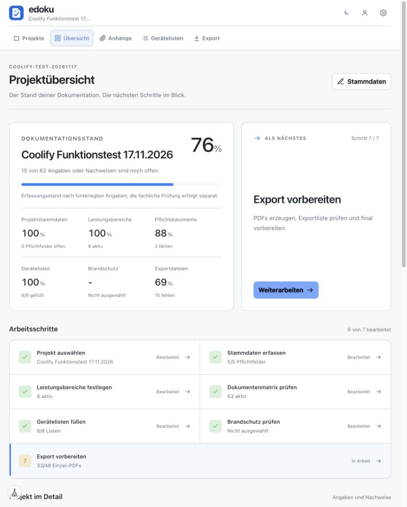
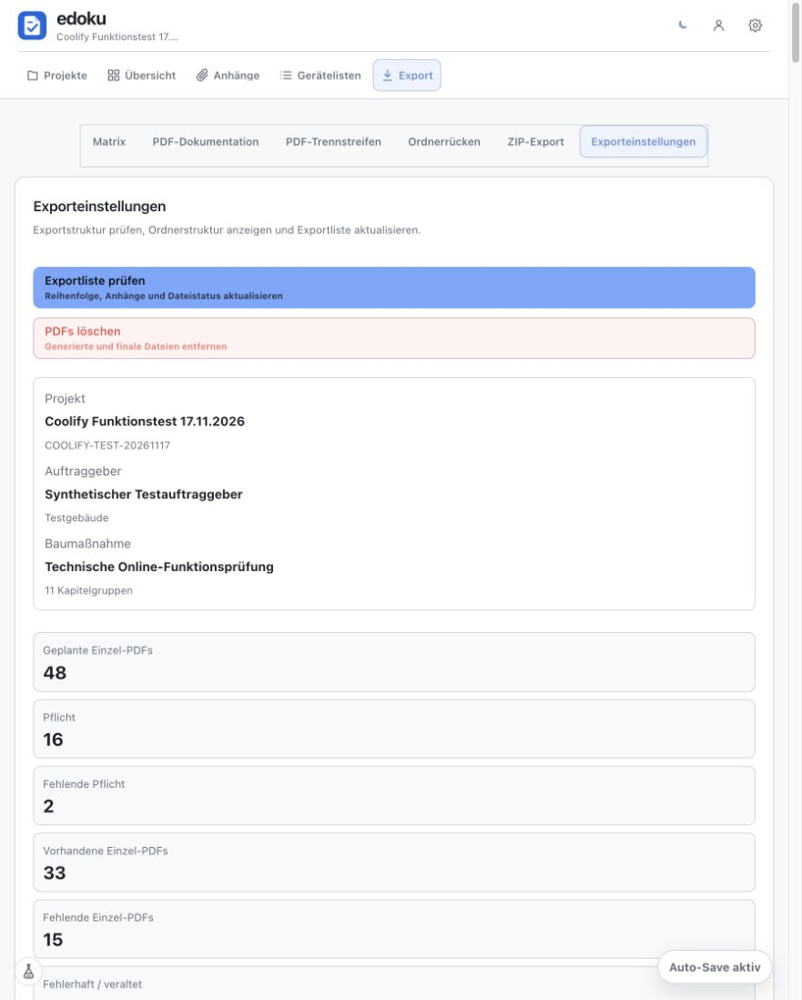

# edoku

**Elektrodokumentation mit Doku-Assistent, API und MCP.**

edoku verbindet Projektstammdaten, Gerätelisten, Brandschutz und technische Unterlagen zu einer geordneten PDF-/ZIP-Dokumentation. Du arbeitest in der Weboberfläche oder verbindest einen Agenten wie Codex über den integrierten **MCP-Server**. edoku gibt den Projektaufbau und die nächsten Aufgaben vor; der Agent ergänzt belegte Informationen und schlägt passende Herstellerunterlagen vor.

**Version `0.3.2`** · HTTP-API/MCP `3.15.0` · **58 MCP-Werkzeuge** · Docker und SQLite.

[](https://github.com/loserat/edoku/actions/workflows/local-beta.yml)

> Jede neue Datei bleibt ein Vorschlag, bis du sie in der GUI einzeln angesehen und manuell freigegeben hast. Ein Agent kann diese Freigabe nicht übernehmen. Softwaretests ersetzen keine fachliche Anlagenabnahme.

## Mit einem Agenten über MCP arbeiten

1. **edoku starten und Zugriff einrichten:** Unter Einstellungen → API/MCP die Integration aktivieren und einen eigenen API-Schlüssel mit den benötigten Rechten anlegen. Möglichst auf die gewünschten Projekte begrenzen.
2. **MCP-Client verbinden:** Codex oder einen anderen Client über den lokalen edoku-MCP-Adapter anbinden. Serveradresse, Schlüssel und freigegebenen Dokumentordner ausschließlich in der privaten Clientkonfiguration speichern. [Einrichtung mit Docker und Codex](docs/CODEX_DOCKER_MCP.md).
3. **Materialliste bereitstellen:** Dem Agenten das Zielprojekt und die neue Materialliste geben. Er beginnt mit `edoku_next_action`, folgt edokus Aufgabensteuerung und bündelt notwendige Rückfragen im Chat.

Der Agent kann Material zuordnen, Geräte und Leistungsbereiche pflegen, Herstellerdatenblätter und erforderliche Anleitungen recherchieren, PDFs auf Artikel-/Variantenpassung prüfen lassen und Dateien zur manuellen Prüfung vorschlagen. Gespeicherte Fakten und Entscheidungen erlauben die Fortsetzung in einem neuen Chat. Offene Freigaben blockieren keine unabhängige Recherche.

Der MCP-Adapter verwendet dieselbe geschützte HTTP-API wie andere Integrationen. 22 Werkzeuge lesen, 36 bearbeiten im Rahmen des API-Schlüssels. Gezieltes Löschen, Wiederherstellung und Projektreset haben eigene Schutzregeln und benötigen einen ausdrücklichen Auftrag. **edoku startet selbst keinen eingebauten KI-Agenten.** Der Client führt die von edoku berechneten Schritte aus und benötigt für Recherchen Zugriff auf die Herstellerquellen. Remote-MCP/OAuth gehört nicht zum beschriebenen lokalen Adapter.

[Anbindung und Ablauf](docs/API_MCP.md) · [Manuelle Dateiprüfung](docs/DOKU_ASSISTENT.md).

## Einstieg

**Für Anwender:** [Bedienungsanleitung](docs/BEDIENUNGSANLEITUNG.md) · [Funktionsüberblick](#funktionen) · [Vereinfachter Doku-Assistent](docs/DOKU_ASSISTENT.md).

**Für Betrieb und Entwicklung:** [Installation](INSTALL.md) · [Coolify](docs/COOLIFY.md) · [Dokumentationsübersicht](docs/README.md) · [Release Notes](docs/RELEASE_NOTES.md).

[**Siebenseitiges Beispiel-PDF auf GitHub ansehen**](https://github.com/loserat/edoku/blob/main/docs/beispiele/edoku-beispieldokumentation.pdf)

## Geprüfter Umfang

Export und Einstellungen verwenden eine schlichte Untermenüleiste direkt unter der Hauptnavigation: mittig, mit normaler Schriftstärke und mobil seitlich scrollbar. Dezente Icon-Bewegungen berücksichtigen reduzierte Bewegung; bei Messprotokollen ist MessPilot optional verlinkt. Die bestehende Einzelprüfung und Freigabe von Dateien bleibt erhalten.

Version 0.3.2 übernimmt aus 0.3.1 die automatische herstellerunabhängige Brandschutz-Aufgabensteuerung, konkrete fehlende Fakten, technische Prüfbefunde und die artikelgebundene OBO-PLM-Maßprüfung. Gespeicherte Originalquellen werden nach einer behobenen Prüfsperre gezielt erneut verwendet. Alle neuen Dateien bleiben manuell einzeln freizugeben; Quelltests, lokale Aktivierung und Online-Deployment sind getrennte Nachweise. Gegenüber 0.3.0-beta.8 ist keine neue Datenmigration erforderlich; frühere Speicher-Upgrades bleiben für ältere Installationen nach der Update-Anleitung maßgeblich. [Tests und Grenzen](docs/TESTS.md).

## Einblick

| Projekt und nächster Arbeitsschritt | Export prüfen, bevor er versendet wird |
| --- | --- |
| [](docs/screenshots/2026-11-17/02-uebersicht.jpg) | [](docs/screenshots/2026-11-17/09b-exportpruefung.jpg) |

Echte Aufnahmen der Anwendung vom 17.11.2026, ausschließlich mit künstlichen Testdaten. Das Beispiel enthält bewusst fehlende Unterlagen: **33 vorhandene von 48 geplanten Einzel-PDFs, 35 tatsächliche Seiten**. Ein erstellter Export ersetzt keine Vollständigkeitsprüfung. [Screenshots und Herkunft](docs/screenshots/README.md).

## Vom Projekt zur Dokumentation

Der lokal aktivierte **Doku-Assistent** zeigt offene Punkte eigener Aufträge direkt. Der verbundene MCP-Agent recherchiert Herstellerunterlagen und stellt echte Rückfragen im Chat. Vorbereitete Dateien bleiben außerhalb der Projektanhänge, bis du sie einzeln geöffnet, gesichtet und ausdrücklich übernommen hast. Dauerhafte PDF-/ZIP-Aufträge warten auf fehlende Angaben und Dateientscheidungen. edoku startet selbst keinen KI-Prozess. [Ablauf und Grenzen](docs/DOKU_ASSISTENT.md).

1. **Projekt auswählen oder anlegen:** Stammdaten, Auftraggeber und Objektstruktur erfassen.
2. **Leistungsbereiche festlegen:** Passende Gerätelisten und Dokumentvorgaben auswählen.
3. **Inhalte ergänzen:** Geräte erfassen, Pläne und Nachweise importieren, Brandschutzfotos zuordnen.
4. **Matrix und PDFs prüfen:** Ausgabeumfang, Kapitel, Pflichtunterlagen und Vorschau kontrollieren.
5. **Export erstellen und freigeben:** Gesamt-PDF, Kapitel-ZIP und Reihenfolgeprotokoll prüfen; fehlende Quellen ergänzen und erneut erzeugen.

Die [bebilderte Bedienungsanleitung](docs/BEDIENUNGSANLEITUNG.md) erklärt jeden Schritt, die Zähler, häufige Fehler und den Unterschied zwischen Dokumentations-ZIP, Projektpaket und Vollsicherung.

## Funktionen

| Bereich | Was edoku unterstützt |
| --- | --- |
| Projekte | Mehrere eigene Projekte, Arbeitskontext, Stammdaten, Stockwerke und Archivstatus |
| Dokumentenmatrix | Ausgabeauswahl, Pflichtkennzeichnung und gemeinsame Kapitelstruktur |
| Gerätelisten | Positionen je Leistungsbereich, Hersteller/System/Typ, Vorlagen und Zuordnung von Bedienungsanleitungen |
| Anhänge | Pläne, Messprotokolle, Nachweise, PDFs und Bilder nach Kategorien |
| Brandschutz | Schottungen, Foto-1-/Foto-2-Zuordnung und Warnungen bei fehlenden referenzierten Dateien |
| PDF und ZIP | Inhaltsverzeichnis, Deckblätter, Formulare, Listen, Gesamt-PDF, Kapitelordner und Reihenfolgeprotokoll |
| Druckhilfen | Separate Trennstreifen sowie Ordnerrücken für `61x192-R` und `38x192-R` |
| Konten | Eigene Projektbereiche, Rollen, Kontosperre und standardmäßig geschlossene Registrierung |
| Oberfläche | Helle/dunkle Darstellung, gemeinsame Navigation und konfigurierbare Themes |
| Betrieb | Eingebettetes SQLite, fünf dauerhafte Datenordner, Sicherheitsprotokoll und geprüfte Sicherungswerkzeuge |

## Lokal mit Docker starten

Für eine **neue lokale Testinstallation in einem neuen Verzeichnis**. Vor dem ersten Start den [eigenen Erstzugang und die Dateirechte](INSTALL.md#eigener-erstzugang-und-bestehende-konten) einrichten. Docker startet im Produktionsmodus und legt ohne eigene Zugangsdaten keine neue Datenbank an:

```bash
git clone --branch main https://github.com/loserat/edoku.git edoku-test
cd edoku-test
# Jetzt den Erstzugang gemäß INSTALL.md privat einrichten.
docker compose up -d --build
```

Danach [http://localhost:3000](http://localhost:3000) öffnen. Der Port muss frei sein. Die Einrichtung eines eigenen Erstkontos und die Alternative ohne Docker stehen in [INSTALL.md](INSTALL.md). Öffentlich erreichbare Neuinstallationen mit einem eigenen Erstkonto einrichten; Anleitung: [Coolify](docs/COOLIFY.md).

**Vorhandene Installation?** Zuerst [Update und Datenerhalt](docs/UPDATE.md) lesen und vollständig sichern. Ein neuer Checkout darf die bestehende Datenablage nicht ersetzen. Keine Volumes oder Datenbankdateien zum Zurücksetzen löschen.

## Coolify und Datenbank

Der mehrstufige Docker-Build enthält Node.js 22, die SQLite-Anbindung und Python für Sicherungswerkzeuge. Beim ersten Start einer echten Neuinstallation entsteht `storage/app.db`. Beide SQLite-Stufen werden für neue Installationen aktiviert; bestehende Installationen wechseln nach geprüfter Sicherung ausdrücklich.

Für Coolify **Dockerfile** mit internem Port `3000` oder die separate `docker-compose.coolify.yml` verwenden. HTTPS, eigene Erstzugangsvariablen und dauerhafte Volumes einrichten. Der Healthcheck `/ready` prüft die tatsächliche SQLite-Bereitschaft. Lokal ergänzt `/api/v1` echte Projektzugriffe mit begrenzbaren API-Schlüsseln und einem lokalen MCP-Adapter. Schreibfunktionen umfassen wiederholungssichere Projektanlage, Stammdaten, Gerätepositionen, Bereichs-/System-/Dokumentauswahl und dauerhafte PDF-/ZIP-Aufträge. Jede vorgeschlagene Datei verlangt weiterhin deine Einzelfreigabe in der GUI. Die lokale Codex-Anbindung ist geprüft; eine Online-Bereitstellung dieses Stands wurde nicht durchgeführt. Die bisherige Demo-API unter `/api` bleibt getrennt erhalten.

[Coolify einrichten](docs/COOLIFY.md) · [SQLite verstehen](docs/SQLITE_PROJEKTDATEN.md) · [API und MCP einrichten](docs/API.md)

## Daten erhalten und sichern

Strukturierte Projektdaten, Konten und Sitzungen liegen in SQLite. Fotos, Anhänge und Ausgabedateien bleiben Dateien; globale Vorgaben und Vorlagen bleiben dateibasiert. Zusammen gehören **`data/`, `config/`, `storage/`, `output/` und `templates/`** zur Sicherung. Historische gemeinsame Ausgaben bleiben separat erhalten. Alte Projekt-JSON-Dateien sind nach SQLite-Aktivierung kein aktueller Spiegel.

| Zweck | Richtiger Weg |
| --- | --- |
| Fertige Unterlagen weitergeben | [Gesamt-PDF und Dokumentations-ZIP](docs/BEDIENUNGSANLEITUNG.md#10-gesamt-pdf-und-zip-erstellen) |
| Ein Projekt zur Weiterbearbeitung übertragen | [Projektpaket mit Manifest und Prüfsummen](docs/PROJEKTARCHIVE.md) |
| Ganze Installation einschließlich Konten und Altbestand absichern | [Vollsicherung und getrennte Wiederherstellung](docs/BETA_BETRIEB.md) |

Eine Kopie auf einem weiteren Datenträger und regelmäßige Wiederherstellungsproben bleiben erforderlich. Private Projekte, Kontodaten, Sicherungen und Laufzeitdateien gehören nicht ins Repository.

## Geprüft und noch offen

- **Automatisiert:** 109 Prüfungen im Node-22-Testabbild bestanden: 101 Node.js- und acht Python-Prüfungen. Paketprüfung am 17.11.2026: keine bekannten npm-Lücken im geprüften Stand.
- **Mit Projektkopien:** Acht bestehende Projekte vor/nach SQLite-Stufe 2 technisch verglichen, einschließlich 249 tatsächlicher PDF-Seiten, Projektpaketen und Rückimporten. Originalbestand erhalten.
- **Online:** HTTPS, Anmeldung, Speichern/Wiederladen, Erhalt über einen Containerwechsel sowie PDF-/ZIP-Erzeugung auf der Testinstanz geprüft. Das künstliche Projekt meldet 15 fehlende PDF-Quellen; der Export ist fachlich unvollständig. Der Download wurde in dieser Runde nicht unabhängig geprüft.
- **Offen:** Fachliche Abnahme, externe Sicherungsorganisation, physische Druckprüfung, weitere Browser-/Barrierefreiheitsfälle, eigener Benutzer-Passwortwechsel und eine vollständige Betriebs-/Sicherheitsabnahme.

Die Nachweise sind datiert. Ein lokaler Testlauf ist kein GitHub-CI-Lauf. [Prüfumfang](docs/TESTS.md) · [Online-Prüfstand](docs/TECHNIK.md) · [Offene Punkte](docs/TESTS.md)

## Entwickeln und mitmachen

Node.js/Express, EJS, Vanilla JavaScript und CSS bilden die Anwendung. Details stehen in [Technik](docs/TECHNIK.md). Tests in einer getrennten Umgebung mit neutralen Startdaten ausführen, da Exporttests Dateien erzeugen:

```bash
npm run check
npm test
```

Tester und Mitentwickler sind willkommen. Bei Fehlern bitte Schritte, erwartetes Ergebnis, tatsächliche Meldung und Programmstand in einem [Issue](https://github.com/loserat/edoku/issues) angeben. Screenshots vorher auf private Daten prüfen; keine Passwörter oder echten Projektarchive hochladen.

## Weiterführende Dokumentation

[Bedienung](docs/BEDIENUNGSANLEITUNG.md) · [Dokumentationsübersicht](docs/README.md) · [Benutzerverwaltung](docs/BENUTZERVERWALTUNG.md) · [Sicherheit](docs/SICHERHEIT.md) · [Brandschutzfotos](docs/BRANDSCHUTZFOTOS.md) · [Changelog](CHANGELOG.md)

**Lizenz:** Noch nicht festgelegt.

## API, MCP und Wartung

Zentraler Einstieg: [API-/MCP-Übersicht](docs/API_MCP.md), [automatisch geprüfter Vertrag](docs/api/README.md), [Architektur und Refactoring](docs/TECHNIK.md), [Speicherpflege auf dem Mac](docs/SICHERHEIT.md). `npm run docs:check` erkennt veraltete Schnittstellendokumentation; `npm run test:maintenance` prüft die neuen Wartungswerkzeuge.

Brandschutzpflichten werden automatisch und herstellerunabhängig aus dem Projektstand abgeleitet; offene Systeme werden gezielt geklärt. Der externe MCP-Agent bearbeitet die Aufgaben, jede neue Datei bleibt bis zur manuellen Einzelprüfung ein Vorschlag. [Ablauf und Voraussetzungen](docs/API_MCP.md#automatische-brandschutzpflichten).
