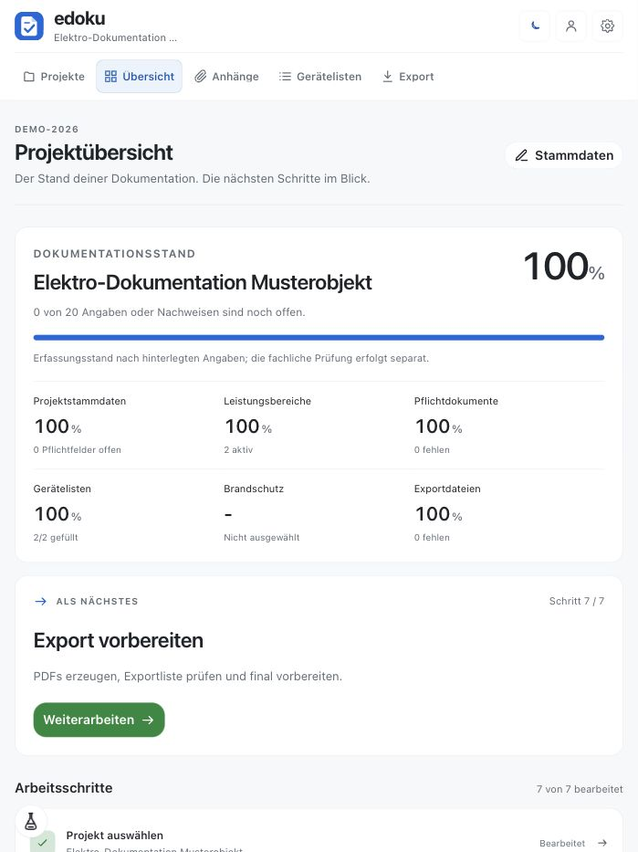
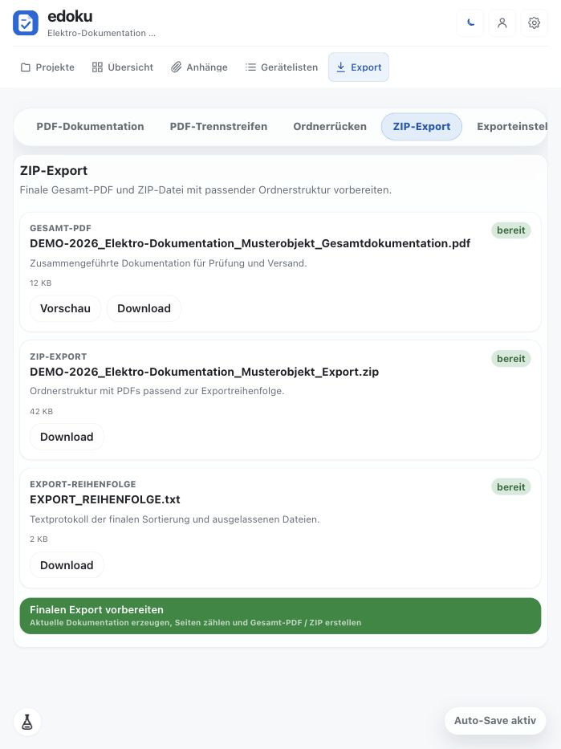
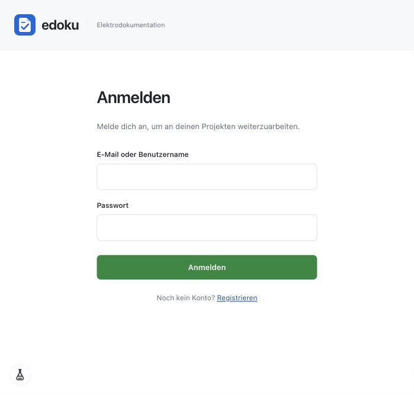
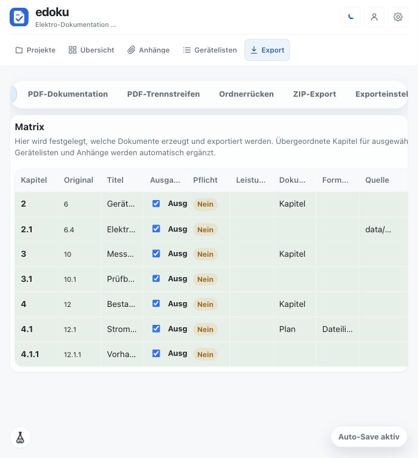
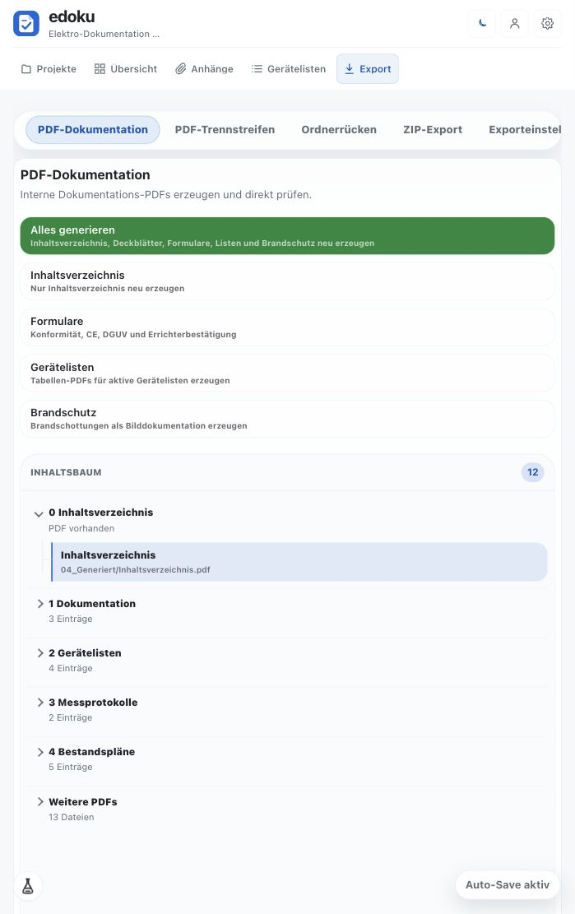

# edoku

<p><strong><span style="color:red;">Mitentwickler gesucht: Ich suche Menschen, die edoku kostenlos testen möchten. Feedback, Fehlerberichte und Ideen sind willkommen. Für Tester gibt es Support innerhalb von 48 Stunden.</span></strong></p>

edoku ist eine lokale Web-Anwendung zur strukturierten Erstellung von Elektro-Bestandsdokumentationen. Die Anwendung verwaltet Projektstammdaten, Leistungsbereiche, Dokumentenmatrix, Gerätelisten, Brandschutzdokumentation, Anhänge, PDF-Erzeugung und Exportvorbereitung.

Version 1 ist bewusst leichtgewichtig aufgebaut:

- Node.js und Express
- EJS-Templates
- Vanilla JavaScript
- eigenes CSS ohne Frontend-Framework
- Vollständige Projektdatensätze in SQLite; JSON für globale Vorgaben und den kompatiblen Altmodus
- SQLite für Benutzer, Sessions, Projektübersicht und strukturierte Projektdaten
- Docker-fähig

## Status

edoku ist aktuell als **Beta-Version** vorgesehen. Die Anwendung ist lokal und per Docker lauffähig und kann bereits für Testläufe, Demo-Projekte und die Weiterentwicklung der Elektro-Bestandsdokumentation genutzt werden.

Die Beta ist noch nicht als produktiv abgesicherte Webserver-Anwendung gedacht. Sicherheitsprotokoll und vollständige Sicherung mit getrennter Wiederherstellung sind vorhanden. Eine zusätzliche Sicherung auf einem anderen Datenträger sowie die fachliche Abnahme mit echten Dokumentationen bleiben offen. 109 automatisierte Prüfungen decken Export, Datenerhalt, Zugriffsgrenzen, Archive, Protokoll, Benutzerverwaltung und SQLite-Speicherung ab.

Die aktuelle Arbeitsliste mit offenen Punkten steht in [docs/OFFENE_PUNKTE.md](docs/OFFENE_PUNKTE.md).
Der kompakte aktuelle Projektstand steht in [docs/AKTUELLER_STAND.md](docs/AKTUELLER_STAND.md).
Änderungen werden zusätzlich im [CHANGELOG.md](CHANGELOG.md) gepflegt.

### Arbeitsstand 6. November 2026

Die geprüften SQLite-Stufen 1 und 2 sind in der normalen lokalen Anwendung aktiviert. Neun strukturierte Projektdatensätze liegen in SQLite; Gerätelisten und Positionen erhalten zusätzlich eigene, atomar synchronisierte Tabellen. Bestehende Konten, Passwörter, Projektinhalte und historische Dateien blieben erhalten. Eine Neuinstallation benötigt keinen separaten Datenbankserver. Dieser Arbeitsstand ist kein neuer Release-Tag.

Sicherheits- und Archivkorrekturen: getrennte Ausgabeablagen je Benutzer und Projekt, begrenzte Dateizugriffe, Schutz schreibender Formulare, zuverlässige Speicherfehler und echte geprüfte Projekt-ZIPs. Gemeinsam genutzte Alt-Ausgaben bleiben als historischer Bestand erhalten. Siehe [Zugriffsschutz](docs/SICHERHEIT.md) und [Projektarchive](docs/PROJEKTARCHIVE.md).

- Ruhige technische Oberfläche mit gemeinsamen Seitenköpfen, Kennzahlenkarten und klarer Navigation.
- Einheitliches Dokument-/Prüfhaken-Icon für Browser, App und Startbildschirm.
- Gemeinsamer Kapitelplan für Matrix, Gerätelisten, importierte PDFs, Inhaltsverzeichnis und Export.
- Tatsächliche PDF-Seitenzahlen, klickbares Inhaltsverzeichnis und fortlaufende finale Dateinummern.
- Dashboard und Export unterscheiden geplante, vorhandene, fehlende und veraltete Dateien sowie Strukturüberschriften.
- Bestehende Konten und Projektdaten bleiben bei Neustarts erhalten; die lokale Hauptanwendung wurde mit vollständiger Sicherung aktualisiert.

Details: [Release Notes](docs/RELEASE_NOTES.md), [Tests und Beta-Abnahme](docs/TESTS.md) und [sicheres lokales Update](docs/UPDATE.md).

### Coolify-Arbeitsstand 17. November 2026

Geprüfte Docker-Laufzeit mit mehrstufigem Build, echtem Bereitschaftscheck unter `/ready`, optionalem eigenem Erstzugang und separater Coolify-Compose-Datei. 109 automatische Prüfungen sowie ein Containeraustausch mit fünf erhaltenen Testvolumes sind erfolgreich. Die tatsächliche Online-Aktivierung und HTTPS müssen zusätzlich am jeweiligen Coolify-Ziel geprüft werden. Einrichtung: [Coolify-Testbetrieb](docs/COOLIFY.md).

## Einblick in die Anwendung

Aufnahmen vom 30.10.2026 in einem schmalen Browserfenster. Alle sichtbaren
Projektangaben sind künstliche Beispieldaten aus einer getrennten
Demo-Installation. Das gezeigte Musterprojekt enthält zwölf Einzel-PDFs mit
20 Seiten; der Erfassungsstand ersetzt keine fachliche Prüfung.

| Projektübersicht | Gesamt-PDF und ZIP-Export |
| --- | --- |
| [](docs/screenshots/uebersicht.jpg) | [](docs/screenshots/zip-export.jpg) |

<details>
<summary>Weitere Screenshots: Anmeldung, Dokumentenmatrix und PDF-Inhaltsbaum</summary>

### Anmeldung



### Dokumentenmatrix

Auswahl der Dokumente mit Original- und Ausgabekapiteln. Breite Tabellen
bleiben in der schmalen Ansicht horizontal bedienbar.



### PDF-Erzeugung und Inhaltsbaum



</details>

## Funktionen

- Login und Logout; Selbstregistrierung standardmäßig geschlossen und nur durch Systemadmins freigebbar
- benutzerbezogene Projektverwaltung
- mehrere Projekte pro Benutzer
- aktuelles Projekt als Arbeitskontext
- Dashboard mit Fortschritt und Kennzahlen
- Projektstammdaten mit Objektstruktur und Stockwerken
- Leistungsbereiche mit Formularvorgaben und Projektzuordnung
- Dokumentenmatrix mit logischer Kapitelnummerierung
- Gerätelisten je Leistungsbereich
- Brandschutzabschottungen mit Foto-Zuordnung über Anhänge
- Anhänge und importierte PDF-Dateien
- Plan-/Messprotokoll-Kategorien für PDF-Importe
- PDF-Erzeugung mit Projektkopf, Logo und optionalem nickgm.de-Branding
- Inhaltsverzeichnis, Formular-PDFs, Gerätelisten und Brandschutz-PDFs
- separate PDF-Trennstreifen im Maß 24 x 10,5 cm
- separate Ordnerrücken für Avery-Zweckform-Formate `61x192-R` und `38x192-R`
- Deckblätter für Hauptkategorien
- Exportliste und finaler Exportordner
- Tag-/Nacht-Theme
- Theme-Editor mit Presets
- Versionsanzeige und GitHub-Update-Prüfung im Systembereich
- schwebende Statusmeldungen, die die Oberfläche nicht verschieben
- Docker-Start
- GitHub-/VS-Code-inspirierte Theme-Presets mit stabilen Layoutgrößen

## Screens und Bedienkonzept

Die Hauptnavigation ist kompakt gehalten:

- Projekte
- Übersicht / aktuelles Projekt
- Anhänge
- Brandschutz
- Gerätelisten
- Export
- System-Icon rechts im Header

Je Hauptbereich werden die Unterpunkte links in der Seitenleiste oder als kompakte Bereichstabs geführt. Links oben im Header steht der Name des aktuell geöffneten Projekts.

## Start mit Docker

```bash
docker compose up --build
```

Danach im Browser öffnen:

```text
http://localhost:3000
```

Im Hintergrund starten:

```bash
docker compose up -d
```

Stoppen:

```bash
docker compose down
```

Logs anzeigen:

```bash
docker compose logs -f
```

## Start ohne Docker

Voraussetzung: Node.js 22 und Python 3.11 oder neuer für Sicherungswerkzeuge und deren Tests. Docker nutzt Node.js 22.

```bash
npm install
npm start
```

Danach im Browser öffnen:

```text
http://localhost:3000
```

## Installation und lokale Defaults

Die Installationsschritte, Hinweise zu lokalen Demo-Konten und erste Setup-Schritte stehen in [INSTALL.md](INSTALL.md).

Die Demo-Zugänge werden ausschließlich bei einer Erstinstallation ohne vorhandene Datenbank angelegt. Ihre Passwörter werden gehasht in SQLite abgelegt. Bestehende Konten, Passwörter, Rollen und Sperren werden bei Neustarts nicht zurückgesetzt.

## Projektstruktur

```text
.
├── config/              # System- und Formular-Konfiguration
├── backups/             # private lokale Sicherungen, nicht für Git oder Docker-Images
├── data/                # globale Startdaten und JSON-Defaults
├── docs/                # technische Doku, Projektupdate und Release Notes
├── intern/              # lokale interne Notizen, größtenteils ignoriert
├── public/              # CSS, JavaScript, Logo
├── services/            # Backend-Services
├── storage/             # lokaler Runtime-Speicher, nicht für Git
├── templates/           # spätere Dokumentvorlagen
├── views/               # EJS-Templates
├── Dockerfile
├── docker-compose.yml
├── package.json
└── server.js
```

## Datenhaltung

Nach geprüfter Aktivierung liegen auch die neun strukturierten Projektdatensätze in SQLite. Gerätelisten und Positionen werden zusätzlich in eigenen, automatisch synchronisierten Tabellen abgebildet. Medien und Ausgabedateien bleiben Dateien. Ältere Installationen ohne Aktivierung behalten zunächst ihre JSON-Ablage. Details: [SQLite-Projektdaten](docs/SQLITE_PROJEKTDATEN.md).

Lokale Laufzeitdaten werden unter `storage/` erzeugt:

```text
storage/app.db
storage/users/[userId]/projects/[projectId]/
storage/exports/
storage/imports/
```

Diese Daten sind in `.gitignore` ausgeschlossen und gehören nicht ins öffentliche Repository.

## Export und PDFs

edoku erzeugt aktuell:

- Inhaltsverzeichnis
- Anlagenbeschreibung unter Kapitel `3.1`
- Deckblätter für Hauptkategorien
- separate Trennstreifen für Unterkategorien
- separate Ordnerrücken für Dokumentationsordner
- Konformitätserklärungen
- CE-Bestätigungen
- DGUV-/Errichterbestätigungen
- Gerätelisten
- Brandschutzseiten mit Platz für Fotos
- Exportliste
- finalen Exportordner

Importierte PDF-Anhänge können über Kategorien wie Stromlaufpläne, Schaltpläne, Installationspläne, Schemata und Messprotokolle in Inhaltsverzeichnis und Exportliste aufgenommen werden.

Anhänge werden kategoriebezogen als Kacheln verwaltet. Datei-Metadaten, Vorschau und Brandschutz-Fotozuordnung laufen über ein Bearbeiten-Popup. Bedienungsanleitungen können optional mit Gerätepositionen in Gerätelisten verknüpft werden.

Trennstreifen werden separat erzeugt und bewusst ohne Footer-Branding gedruckt. Der Standarddruck ist tintensparend: schwarze Kapitelnummer am Registerrand, keine blaue Fläche und kein zusätzlicher Projekttext.

Ordnerrücken werden unter `Export > Ordnerrücken` als separate PDF erzeugt. Unterstützt sind Avery-Zweckform-Bögen `61x192-R` mit 4 Rücken je A4-Seite und `38x192-R` mit 7 Rücken je A4-Seite. Der Text wird gedreht, zentriert im Rücken angeordnet und kann Projektname, Projektnummer, Auftraggeber, Liegenschaft, Baumaßnahme und Ordnernummer enthalten. Die Ordneranzahl kann manuell gesetzt oder aus den tatsächlichen vorhandenen PDF-Seiten und der einstellbaren Kapazität geschätzt werden (Standard: 80 Seiten pro Ordner). Der physische Ausdruck und die Ordnerkapazität müssen praktisch geprüft werden.

Der finale Export aktualisiert interne PDFs und erstellt eine Gesamt-PDF mit klickbarem Inhaltsverzeichnis sowie ein ZIP mit Kapitelordnern. Mehrseitige Anhänge zählen mit ihrer tatsächlichen Seitenzahl. Überschriften ohne eigene Datei, die Gesamt-PDF und separate Druckvorlagen erhöhen die Anzahl der Einzel-PDFs nicht. Fehlende, unlesbare oder veraltete Dateien werden ausgewiesen.

Das Softwareupdate selbst verändert vorhandene PDFs nicht. Ältere generierte PDFs können als veraltet erscheinen; die neue Struktur greift beim nächsten bewusst gestarteten Export.

Gerätelisten können über das Drei-Punkte-Menü als systemweite Vorlage gespeichert werden. Die Verwaltung erfolgt unter `System > Gerätelisten`; passende Vorlagen können später wieder in Gerätelisten geladen werden.

Systemadmins können unter `System > System` das sichtbare edoku-/nickgm-Branding für Oberfläche und PDF-Exporte deaktivieren. Das ist als Vollversions-/Lizenzoption vorbereitet; projektbezogene Logos und Erstellerlogos bleiben davon unabhängig.

## Sicherung und Sicherheitsprotokoll

Systemadmins finden das Sicherheitsprotokoll unter **System → Sicherheitsprotokoll**. Eine vollständige Sicherung enthält alle fünf Laufzeitordner, die Datenbank und standardmäßig das passende Docker-Abbild. Die Wiederherstellung erfolgt ausschließlich in einen neuen Ordner. Anleitung und Grenzen: [Lokaler Beta-Betrieb](docs/BETA_BETRIEB.md).

## Brandschutzfotos

Fehlende referenzierte Fotos werden in Brandschutz, Dashboard, Export sowie im ZIP-Protokoll angezeigt. Ein Export mit Fotowarnungen gilt nicht als vollständig; vorhandene Projekte und Dateiverweise werden dabei nicht verändert. Details: [Brandschutzfotos prüfen](docs/BRANDSCHUTZFOTOS.md).

## Tests

Die vollständige Suite im getrennten Testcheckout oder Container mit neutralen Startdaten ausführen:

```bash
npm run check
npm test
```

109 Prüfungen (101 Node.js, acht Python) sind im geprüften Node-22-Abbild erfolgreich. Sie umfassen unter anderem Kapitel-/Seitenzählung, Inhaltsverzeichnis-Links, Benutzerrechte, Archiv-Rückimport, SQLite-Transaktionen, paralleles Speichern und Wiederherstellung. Tests nicht mit den normalen Laufzeitordnern verbinden: Einige Exporttests schreiben eigene PDF-Nachweise.

Zusätzlich wurden acht bestehende Projekte ausschließlich auf Kopien vor/nach der Geräteumstellung verglichen: gleiche Exporte mit 249 tatsächlichen PDF-Seiten. Das ist eine technische Prüfung, keine fachliche Freigabe. Alle Einzelbefehle und Grenzen stehen unter [Tests und Beta-Abnahme](docs/TESTS.md).

## Theme-System

Das Theme-System nutzt zentrale CSS-Variablen für Farben, Radien, Schatten, Abstände und Typografie. Der Editor ist bewusst auf die wichtigsten Werte begrenzt und orientiert sich farblich an GitHub-/VS-Code-Themes. Die Presets verwenden identische Radius-, Spacing- und Typografiewerte, damit beim Wechsel keine sichtbaren Layoutsprünge entstehen.

Aktuelle Presets:

- GitHub Light Default
- GitHub Light High Contrast
- GitHub Light Colorblind
- GitHub Dark Default
- GitHub Dark High Contrast
- GitHub Dark Colorblind
- GitHub Dark Dimmed

## GitHub-Hinweise

Diese Inhalte sollen ins Repository:

- Quellcode
- Views
- CSS und Frontend-JS
- Konfigurationsdateien
- JSON-Startdaten
- Dokumentation
- Docker-Dateien

Diese Inhalte sollen nicht ins Repository:

- `node_modules/`
- `output/`
- `storage/` außer `storage/README.md`
- `backups/`
- lokale Änderungen an `config/systemEinstellungen.json` und `config/geraetelistenVorlagen.json`
- `.env`
- `.DS_Store`
- interne Tagesupdates und lokale Arbeitsnotizen

Siehe auch:

- [Dokumentationsübersicht](docs/README.md)
- [Technische Dokumentation](docs/TECHNIK.md)
- [SQLite-Stufen, Datenmodell und Rückweg](docs/SQLITE_PROJEKTDATEN.md)
- [Benutzerverwaltung](docs/BENUTZERVERWALTUNG.md)
- [Gestaltung](docs/GESTALTUNG.md)
- [Brandschutzfotos und Exportwarnungen](docs/BRANDSCHUTZFOTOS.md)
- [Installation](INSTALL.md)
- [Coolify-Testbetrieb](docs/COOLIFY.md)
- [Aktueller Stand](docs/AKTUELLER_STAND.md)
- [Changelog](CHANGELOG.md)
- [Repo-Sicherheitscheck](docs/REPO_SICHERHEITSCHECK.md)
- [Projektupdate](docs/PROJEKTUPDATE.md)
- [Release Notes](docs/RELEASE_NOTES.md)
- [Tests und Beta-Abnahme](docs/TESTS.md)
- [Lokales Update und Datensicherung](docs/UPDATE.md)
- [Zugriffsschutz und Datenerhalt](docs/SICHERHEIT.md)
- [Projektarchive und Wiederherstellung](docs/PROJEKTARCHIVE.md)

## Aktuelle Grenzen

- eingebettetes SQLite, keine externe Datenbank; die Gerätezeilen sind derzeit eine Projektion des vollständigen Datensatzes
- Rollenverwaltung ist als Beta-Funktion vorhanden und muss für produktiven Serverbetrieb weiter gehärtet werden
- PDF-Gesamtdatei und ZIP-Export sind als Beta-Funktion vorhanden und müssen weiter visuell geprüft werden
- automatisierte Prüfungen decken Exportzählung, Datenerhalt und zentrale Sicherheits-/Archivfälle ab; vollständige Browser-, Fach- und Betriebsabnahme bleibt offen

## Lizenz

Noch nicht festgelegt.
