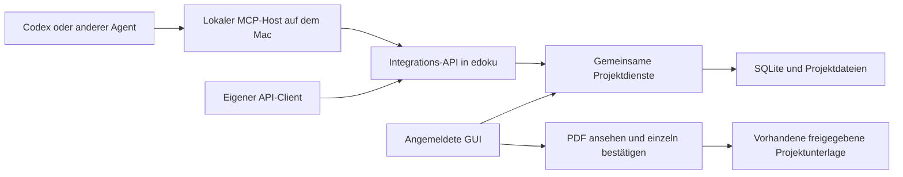

# API und MCP: Übersicht und Einstieg

Stand **25.11.2026**: lokal aktiv **App 0.3.0-beta.2 / HTTP-API und MCP 3.9.0**, **64 HTTP-Operationen und 55 MCP-Werkzeuge (22 Lesen / 33 Schreiben)**. Agentenvertrag 2.1, Produktprüfung V7. Die vereinfachte Oberfläche ist nach geprüfter Vollsicherung und getrennter Wiederherstellungsprobe lokal aktiviert. Neue Dateien weiterhin ausschließlich manuell einzeln in der GUI freigeben.

Änderungen, Tests und lokale Aktivierungen beider Tage: **[Entwicklungsupdate 23.–24.11.2026](ENTWICKLUNGSUPDATE_2026-11-23_24.md)**. Frühere Tagesabschlüsse und vorbereitete Nachweise beschreiben ihren damaligen Zeitpunkt; sie sind keine aktuellen Aktivierungsaufträge.

Der [erzeugte Vertrag](api/README.md) führt Routen, Rechte, Eingaben und tatsächliche MCP-Zuordnungen. Neu in 3.9.0: [Dateivorschläge begründet zurückziehen](DATEIVORSCHLAEGE_ZURUECKZIEHEN.md); keine API-/MCP-Dateifreigabe. Die [zentrale Aufgabensteuerung](ZENTRALE_AUFGABENSTEUERUNG.md) und [Produktprüfung](PRODUKTPRUEFUNG.md) bleiben führend. Für Einzellöschung/Wiederherstellung und Projektreset gelten weiterhin ausdrücklicher Auftrag und die jeweiligen Schutzregeln.

## Wo welche Information steht

| Anliegen | Führende Stelle |
| --- | --- |
| App-, API-/MCP- und Fachregelversionen | [Versionsschema](VERSIONIERUNG.md) |
| Alle Routen, Rechte, Pflichtargumente und MCP-Zuordnungen | **[Erzeugtes Vertragsinventar](api/README.md)** |
| Vollständige HTTP-Schemas | [OpenAPI-Datei](api/openapi.json), live `GET /api/v1/openapi.json` |
| Tatsächliche MCP-Schemas und Serveranweisungen | [MCP-Katalog](api/mcp-tools.json) |
| Authentifizierung, Beispiele, Fehler und Fachdetails | [API-Handbuch](API.md) |
| Installation und Codex-Anbindung | [Docker/MCP-Betrieb](CODEX_DOCKER_MCP.md) |
| Verbindliche Arbeit an realen Dokumentationen | [Bearbeitungsrichtlinie](BEARBEITUNGSRICHTLINIE.md), [Agentenablauf](AGENTENABLAUF.md) |
| Datenblattabdeckung und ihre Grenzen | [Datenblattprüfung](DATENBLATTPRUEFUNG.md) |
| Wo sicher refaktoriert werden kann | [Architektur und Refactoring](API_MCP_REFACTORING.md) |
| Laufende Version, Tests, Sicherungen und reale offene Punkte | [Aktueller Stand](AKTUELLER_STAND.md), [Tests](TESTS.md), [Tagesabschluss](TAGESABSCHLUSS_2026-11-24.md) |
| Projektbezogener Platzverbrauch und sichere Pflege | [Speicherpflege](SPEICHERPFLEGE.md) |
| Noch nicht implementierte Verbesserungen | [Ausbauplan](MCP_API_OPTIMIERUNG.md) |

Die erzeugten Referenzen stammen aus dem aktuellen Quellstand. Ein laufender Server oder ein bereits verbundener MCP-Client kann einen älteren Stand besitzen. Ein Quellvergleich und eine echte Verbindung prüfen die Bereitstellung getrennt. Alte Tagesabschlüsse bleiben historische Nachweise.

## Zuständigkeiten und Sicherheitsgrenzen



edoku liefert Listen, erlaubte Felder, Leistungsbereiche, Kapitel, Anforderungen und nächste Schritte. Der externe Agent recherchiert Herstellerquellen und fragt echte Einbaudaten im Chat ab. edoku führt keinen dauerhaften KI-Rechercheprozess aus. Der Export besitzt einen eigenen Hintergrundarbeiter.

Die Integrations-API verwendet einen benutzergebundenen Schlüssel mit Rechten, Ablaufdatum und optionaler Projektbeschränkung. Schreibfreischaltung in den Einstellungen und Rollenprüfung gelten zusätzlich. Ein MCP-Werkzeughinweis wie `readOnlyHint` erteilt keine Berechtigung. Maßgeblich bleiben die tatsächlichen HTTP-Routenschutzprüfungen.

**API und MCP können keine Datei freigeben.** Jede neue Datei benötigt die angemeldete GUI, gerenderte Sichtung, aktuelle Prüfsumme und manuelle Einzelbestätigung. Eine bereits freigegebene und unveränderte Datei darf weiteren bestätigten Instanzen desselben Artikels zugeordnet werden. Eine neue ähnliche Datei übernimmt dadurch keine alte Freigabe.

## Arbeitsablauf für einen Agenten

1. Falls unbekannt, Identität und passende Projekt-/Auftragskennung lesen. Mit dem kompakten `edoku_next_action` im tatsächlichen Projekt beginnen. Gespeicherte Entscheidungen und bisherige Zurückstellungen beachten.
2. Bestehende Listen, Positionen und erlaubte `fields` nutzen. Materialtexte müssen zuerst in die richtigen Listen eingeordnet werden. Aus Herstellerunterlagen keinen tatsächlichen Einbau ableiten.
3. Die bestandsweite Datenblattabdeckung abarbeiten. Gleiche Artikel/Varianten einmal recherchieren und alle passenden Instanzen referenzieren. Vorhandene Originale vor neuen Vorschlägen nutzen. Belegte Nichtfunde speichern, unklare Varianten gezielt klären.
4. Tatsächliche Rückfrage über `edoku_ask_question` in edoku festhalten und im Agentenchat stellen. Neue erhaltene Antworten mit `edoku_record_chat_decision`, Originalbeleg und ausdrücklicher Einordnung speichern; den zurückgegebenen Plan verwenden. Die passende Fachfeldänderung bleibt derzeit ein eigener Schritt; eine atomare Zusammenfassung ist noch geplant.
5. Original-PDFs mit Hersteller-Produktseite in `metadata.manufacturerPageUrl` und dort verlinkter HTTPS-PDF-Adresse in `metadata.sourceUrl` an `edoku_propose_document` übergeben; `filePath` ist optional. Die API lädt und prüft das Original vor dem Vorschlag ([Produktprüfung](PRODUKTPRUEFUNG.md)). Lokale Originale unter dem erlaubten Ordner bleiben nutzbar. Datenblatt und Anleitung bleiben getrennte Kategorien und Geräteverknüpfungen. Projekttexte standardmäßig intern halten.
6. Nach jedem gespeicherten Schritt den aktuellen Plan erneut lesen. Bereits vorgemerkte Vorschläge, Ablehnungen und unbekannte Einbaudaten nicht durch neue gleichartige Aufgaben umgehen.
7. Auf manuelle Dateientscheidungen warten. Bereits freigegebene Originale bei Bedarf mit `edoku_link_existing_document` zuordnen. Fehlerhafte alte Geräteanforderungen nur nach ausdrücklicher Benutzerkorrektur mit `edoku_correct_requirement_devices` und erhaltenem Vorher-/Nachher-Protokoll berichtigen.
8. Bereitschaft und Kundenumfang prüfen, Export beauftragen und dessen Ergebnis abholen. Fehlende Originalpläne oder Messprotokolle bleiben offen. Technische Erzeugung ersetzt keine fachliche Abnahme.

`edoku_next_action` liefert standardmäßig `view=compact`; `sinceCheckpoint` vermeidet unveränderte Wiederholungen. `limit` begrenzt die Aufgabenliste. Allgemeine Zurückstellungen sind über `edoku_record_document_work` implementiert und werden im Plan berücksichtigt. Für Artikel gezielt `edoku_datasheet_coverage` lesen; Historie und vollständige Struktur nur bei Bedarf laden. Gebündelte Chatentscheidungen und unveränderte Checkpoints sind implementiert; weitere fachliche Sammeländerungen bleiben Ausbaupunkte.

## Drei verschiedene Schutzmechanismen

| Mechanismus | Woher | Wofür | Bei Konflikt |
| --- | --- | --- | --- |
| Projekt-ETag | Projektbezogene Leseantwort, z. B. `edoku_get_project`; einschließlich Anführungszeichen | Projektstammdaten, Auswahl, Geräte, Zuordnungen, Suchnachweise und explizite Anforderungskorrektur | Bei 412 betroffene Daten neu lesen und vergleichen |
| Auftragsversion `version` bzw. `jobVersion` | Aktuell gelesener Dokumentationsauftrag | Antworten, Ablösungen, zielbezogene Fragen, Korrekturen und bedingte Umfangsänderungen | Frischen Auftrag lesen; neue Benutzerentscheidung beachten |
| Wiederholungsschlüssel `requestId` / `Idempotency-Key` | Vom Client für einen beabsichtigten Vorgang erzeugt | Projekt-/Auftrags-/Positionsanlage, Kapitelvorbereitung und Exportauftrag entsprechend Vertrag | Gleichen Vorgang mit gleichem Schlüssel abgleichen; für bewusst neuen Vorgang neuen Schlüssel verwenden |

Ein allgemeiner schwacher HTTP-ETag der Antwort ist kein projektweiter starker ETag. Nicht aus beliebigen Schreibantworten einen neuen Projekttoken ableiten. Der anschließende Plan-/Projektabruf liefert den passenden aktuellen Stand. Ein Auftrag kann sich ändern, ohne dass der Projekt-ETag alle Dateientscheidungen abbildet; deshalb bei betroffenen Vorgängen beide Versionen verwenden.

Der allgemeine Auftrags-PATCH darf vorhandene Anforderungen weiterhin nicht still verändern. Der ausdrückliche Korrekturweg erhält ID/Titel und protokolliert ursprünglichen und korrigierten Bezug. `device` bleibt für ältere Einzelanforderungen unterstützt; `devices` erfasst mehrere reale Instanzen. Alle benötigten Instanzen müssen durch das passende freigegebene Original abgedeckt sein.

## Zustände richtig lesen

| Angabe | Aussage | Belegt damit nicht |
| --- | --- | --- |
| Artikel `pending` | Die noch fehlenden Bezüge sind durch offene Vorschläge abgedeckt | Manuelle Freigabe |
| Artikel `approved` | Alle Instanzen des Artikels besitzen passende freigegebene PDF-Bezüge | Vollständige gesamte Anlagendokumentation |
| Artikel `not_found` | Eine belegte Suche war bisher erfolglos | Dauerhafte Nichtverfügbarkeit oder Befreiung von einer Pflicht |
| `datasheets.complete` | Alle relevanten Artikel sind freigegeben abgedeckt | Reale Messwerte, Bestandspläne oder fachliche Abnahme |
| `requirements[].fulfilled` | Diese konkrete Pflichtanforderung ist erfüllt | Alle Artikel wurden überhaupt geprüft |
| `canGenerate` / `inputComplete` | Bestehende Voraussetzungen nach dem bisherigen Bereitschaftsvertrag | Vollständige Datenblattabdeckung |
| Export `succeeded` und `current` | Technische Ausgabe erfolgreich und zum aktuellen Projektstand passend | Fachliche Abnahme; diese bleibt `not_assessed` |

Für Beispielprojekt A sind beispielsweise 46/60 Artikel abgedeckt, während 30/33 Kundenanforderungen erfüllt sind. Diese Größen beantworten verschiedene Fragen. Reale Ergebnisse stets frisch lesen; diese Beispielzahlen sind kein unveränderlicher Vertragswert.

## Dokumentation dauerhaft aktuell halten

```sh
npm run docs:api
npm run docs:check
npm run test:maintenance
npm run check
```

`docs:api` liest den OpenAPI-Vertrag und startet den echten MCP-Server zweimal mit einem synthetischen unbrauchbaren Schlüssel und deaktiviertem API-Ziel: Lese- und Vollkatalog. Es ruft ausschließlich `initialize` und `tools/list` auf; keine Projekt-, Recherche-, Dateifreigabe- oder Netzwerkanfrage an die echte Installation.

Erzeugt werden `docs/api/README.md`, `openapi.json`, `mcp-tools.json` und `manifest.json`. Das Manifest hält die Versionen und Prüfsummen relevanter Schnittstellenmodule fest. Ein neues Werkzeug ohne gepflegte API-Zuordnung oder eine veraltete Referenz lässt die Prüfung scheitern. Die CI-Konfiguration enthält diese Prüfung; ihre tatsächliche Ausführung auf GitHub setzt eine gesonderte Veröffentlichung voraus.

Die Zuordnung Werkzeug → operationId ist ausdrücklich gepflegt und auf Vollständigkeit geprüft. Sie ist kein automatisch bewiesener Nachweis der Callback- oder Berechtigungslogik. Dafür bleiben echte HTTP-/MCP-Tests erforderlich. Änderungen am Verhalten müssen zusätzlich in den passenden Fachanleitungen beschrieben werden; bloßes Neuerzeugen von Prüfsummen ist keine Abnahme.

Geheimnisse, private Verbindungseinstellungen, Projektdaten und Sicherungsinhalte gehören weder in die erzeugten Dokumente noch ins Repository. Aktueller Schlüssel und lokale Hostpfade bleiben privat. Nach Vertragsänderungen muss ein bestehender Client seinen Werkzeugkatalog neu laden; ein Containerneustart allein erneuert den Katalog nicht zuverlässig.

## Kompakte Fortsetzung ab API 1.5 / MCP 1.6

`GET /api/v1/projects/{projectId}/next-action?jobId={jobId}&view=compact` liefert denselben nächsten Schritt, Checkpoint, Projekt-ETag, Auftragsversion, Schutzkern, Statuszähler und fachliche Bereitschaft wie der Vollmodus. Struktur und Historie werden nicht erneut übertragen. `contextTool` verweist auf den vollständigen Plan. Unbekannte Ansichten werden abgewiesen; Projekt- und Leserechte bleiben gleich. Standard ist unverändert `view=full`.

Das MCP-Werkzeug akzeptiert dieselbe Ansicht. Im kompakten Modus enthält nur `structuredContent` die Nutzdaten; der Textkanal liefert eine kurze Statuszeile mit Freigabehinweis. Reine Textclients bleiben beim Vollmodus. Das ist kein Änderungsabruf, kein Tokenabrechnungsnachweis und keine neue Dateifreigabemöglichkeit. Der Checkpoint bleibt eine Zustandskennung ohne Abruffunktion.

`waiting` unterscheidet bisher nicht gefundene Datenblätter, unklare Artikel, offene Dateiprüfungen und abgelehnte interne Entwürfe. Nichtfunde und interne Ablehnungen starten keine erneute automatische Bearbeitungsschleife und gelten weiterhin nicht als erfüllte Unterlagen. Echte Kundenpflichtquellen bleiben offen. Einzelheiten: [Tagesziel 20.11.](TAGESABSCHLUSS_2026-11-20.md).
