# Bedienungsanleitung

**Mit edoku vom leeren Projekt zur geordneten Elektro-Bestandsdokumentation.**

Diese Anleitung erklärt die tägliche Nutzung der Anwendung: Projekte bearbeiten, Unterlagen zuordnen, Dokumente prüfen und Ausgaben erstellen. Sie richtet sich an Anwenderinnen und Anwender. Installation, Servereinrichtung und technische Administration sind kein Bestandteil dieser Anleitung.

Stand: **17.11.2026**, Oberfläche `0.1.0-beta.1`. Die Screenshots zeigen ein künstliches Testprojekt. Angaben wie Firmennamen, Geräte und Projektfortschritt sind Beispiele. Auf schmalen Bildschirmen können Tabellen innerhalb ihres Bereichs seitlich gescrollt werden.

## Inhalt

1. [Anmelden und orientieren](#1-anmelden-und-orientieren)
2. [Projekt auswählen oder anlegen](#2-projekt-auswählen-oder-anlegen)
3. [Stammdaten erfassen](#3-stammdaten-erfassen)
4. [Leistungsbereiche festlegen](#4-leistungsbereiche-festlegen)
5. [Dokumentenmatrix prüfen](#5-dokumentenmatrix-prüfen)
6. [Gerätelisten bearbeiten](#6-gerätelisten-bearbeiten)
7. [Anhänge und Nachweise verwalten](#7-anhänge-und-nachweise-verwalten)
8. [Brandschutz dokumentieren](#8-brandschutz-dokumentieren)
9. [PDF-Dokumentation erzeugen und prüfen](#9-pdf-dokumentation-erzeugen-und-prüfen)
10. [Gesamt-PDF und ZIP erstellen](#10-gesamt-pdf-und-zip-erstellen)
11. [Trennstreifen und Ordnerrücken drucken](#11-trennstreifen-und-ordnerrücken-drucken)
12. [Projektpakete und Archiv verwenden](#12-projektpakete-und-archiv-verwenden)
13. [Darstellung und Einstellungen](#13-darstellung-und-einstellungen)
14. [Konten und Rollen verstehen](#14-konten-und-rollen-verstehen)
15. [Häufige Fragen und Fehlermeldungen](#15-häufige-fragen-und-fehlermeldungen)
16. [Checkliste vor der Weitergabe](#16-checkliste-vor-der-weitergabe)

## 1. Anmelden und orientieren

1. Die von deiner Organisation bereitgestellte edoku-Adresse im Browser öffnen.
2. Mit dem zugewiesenen Benutzernamen und Passwort anmelden. Bei vergessenen Zugangsdaten den zuständigen Systemadmin ansprechen.
3. Unter **Projekte** ein Projekt auswählen. Links oben steht der aktuell geöffnete Projektname. Vor Änderungen und vor jedem Export diesen Namen prüfen.
4. Unter **Übersicht** den Erfassungsstand und den nächsten Arbeitsschritt ansehen.

| Bereich | Wofür du ihn nutzt |
| --- | --- |
| Projekte | Projekt öffnen, Stammdaten und Leistungsbereiche bearbeiten, Archiv und Pakete aufrufen |
| Übersicht | Offene Angaben und Nachweise erkennen, zum nächsten Arbeitsschritt wechseln |
| Anhänge | Pläne, Messprotokolle, Bedienungsanleitungen, Fotos und Nachweise verwalten |
| Gerätelisten | Gerätepositionen je ausgewähltem Leistungsbereich erfassen |
| Export | Dokumentenmatrix, PDF-Vorschau, Gesamt-PDF, ZIP und Druckhilfen |
| Einstellungen, Zahnrad | Darstellung und – abhängig von deiner Rolle – globale Vorgaben und Konten |
| Benutzermenü | Angemeldetes Konto ansehen und abmelden |

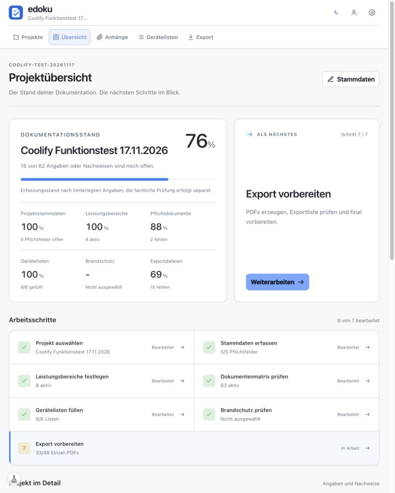

**So liest du den Fortschritt:** Der Prozentwert beschreibt den Erfassungsstand hinterlegter Angaben. Er bestätigt weder die fachliche Richtigkeit noch die Eignung eines Nachweises. „Bearbeitet“ bei einem Arbeitsschritt ist ebenfalls keine fachliche Freigabe. „Nicht ausgewählt“ beim Brandschutz bedeutet, dass dieser Leistungsbereich aktuell nicht zum gewählten Umfang gehört.

**Speichern:** Viele Eingabeformulare speichern automatisch. Nach einer Änderung auf **Gespeichert** warten. Ein Hinweis „Auto-Save aktiv“ allein bestätigt noch keine konkrete Speicherung. Dialoge und Aktionen mit **Speichern**, **Import speichern** oder **Erzeugen** müssen ausdrücklich bestätigt werden. Bei einer Fehlermeldung die Seite nicht sofort schließen; siehe [Fehlerhilfe](#15-häufige-fragen-und-fehlermeldungen).

## 2. Projekt auswählen oder anlegen

1. **Projekte** öffnen. Die Projektliste zeigt deine verfügbaren Projekte; der aktive Eintrag ist gekennzeichnet.
2. Zum Wechsel den gewünschten Projektnamen auswählen.
3. Für ein neues Projekt das **Plus** mit der Bezeichnung **Neues Projekt anlegen** wählen. Dadurch wird bereits ein Projekt angelegt und die Stammdatenansicht geöffnet.
4. Den vorgegebenen Namen durch einen eindeutigen Projektnamen ersetzen und eine Projektnummer eintragen.
5. Nach dem Speichern den Projektkopf kontrollieren.

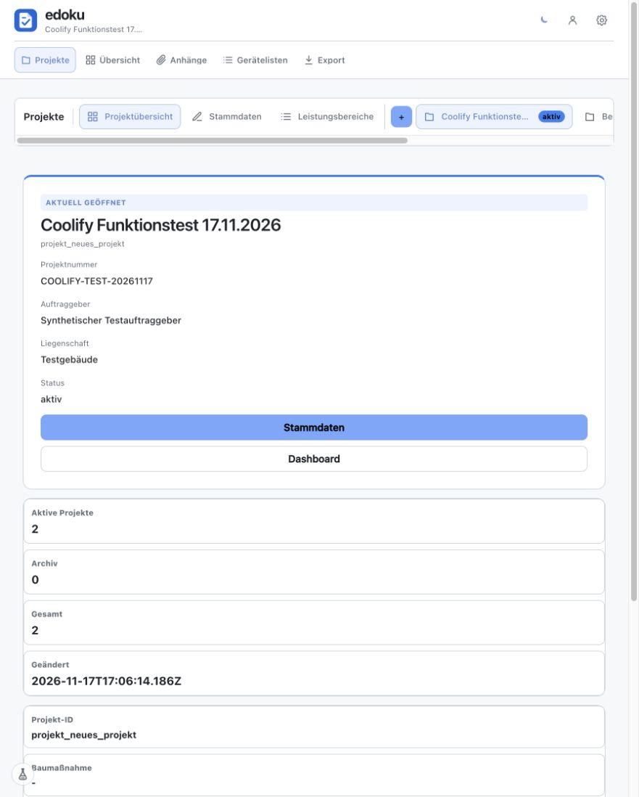

Das Umbenennen eines Projekts wählt kein anderes Projekt aus. Für parallele Arbeiten nach Möglichkeit jeweils klar prüfen, welches Projekt im Browser geöffnet ist.

## 3. Stammdaten erfassen

Unter **Projekte → Stammdaten** die Angaben für Projektkopf und Ausgaben pflegen:

1. Projektname, Projektnummer, Auftraggeber, Liegenschaft und Baumaßnahme ausfüllen.
2. Auftragsangaben und Gewerk ergänzen.
3. Unter **Objektstruktur → Stockwerke** die tatsächlich vorhandenen Geschosse auswählen. Sonderfälle unter **Weitere Stockwerke** eintragen.
4. Ausführende Firma, Anschrift, Bearbeiter sowie Ort und Datum ergänzen.
5. Auf die Speicherbestätigung warten und anschließend in der Übersicht prüfen, ob Pflichtangaben fehlen.

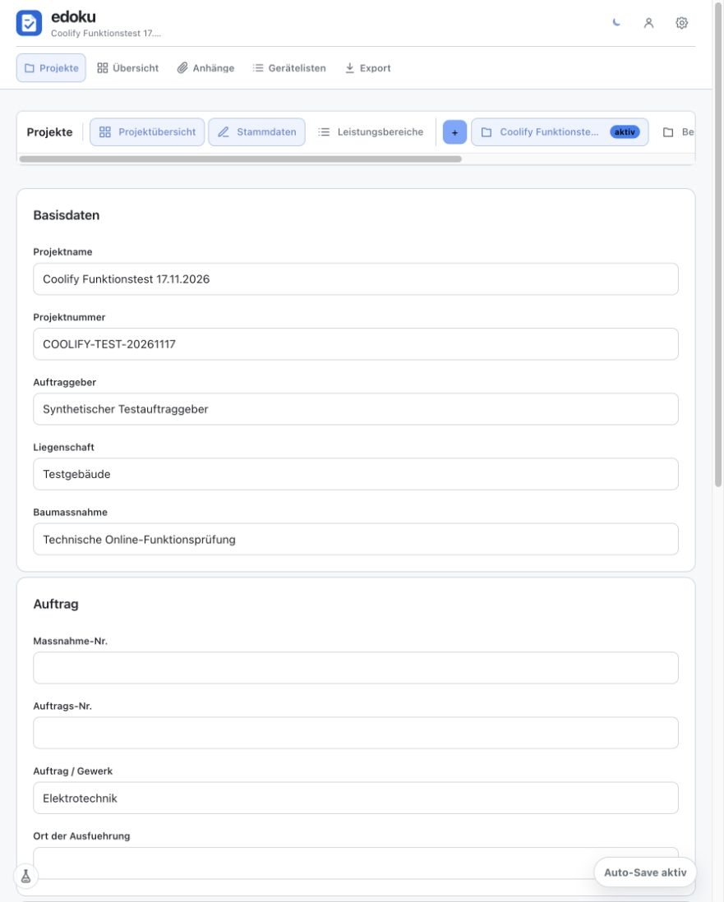

Sinnvolle, eindeutige Projektangaben erleichtern später die Zuordnung der PDFs. Vorlagenwerte und Musterfirmen durch die tatsächlichen Angaben ersetzen.

## 4. Leistungsbereiche festlegen

1. **Projekte → Leistungsbereiche** öffnen.
2. Alle zum Auftrag gehörenden Bereiche auswählen, beispielsweise Elektroinstallation, Sicherheitsbeleuchtung oder Brandschutzabschottungen.
3. Die **Aktive Auswahl** kontrollieren und die Speicherbestätigung abwarten.
4. Anschließend Gerätelisten und Dokumentenmatrix prüfen: Der gewählte Umfang beeinflusst die angebotenen Listen und Dokumente.

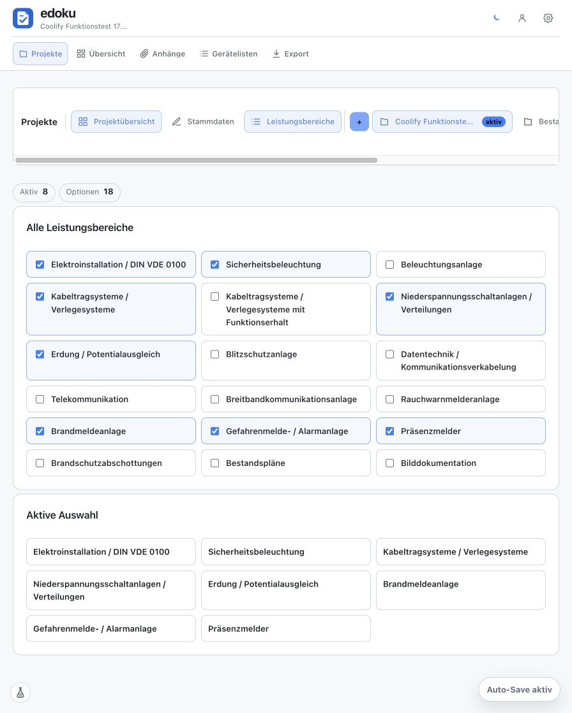

Bereiche nach dem tatsächlichen Auftrag auswählen. Einen benötigten Bereich nicht abwählen, nur um fehlende Unterlagen aus dem Fortschritt zu entfernen. Beim Abwählen etwaige Hinweise und Bestätigungen sorgfältig lesen.

## 5. Dokumentenmatrix prüfen

Unter **Export → Matrix** legst du fest, welche Einträge zur Dokumentation gehören.

1. Den Titel und den zugehörigen Leistungsbereich jeder relevanten Zeile prüfen.
2. Über **Ausgabe** die gewünschte Ausgabe auswählen.
3. **Pflicht**, Dokumenttyp und **Quelle** beachten. Ein manuell zu liefernder Nachweis entsteht nicht automatisch durch Anklicken.
4. Die angezeigten Ausgabekapitel kontrollieren. Übergeordnete Kapitel für ausgewählte Gerätelisten und Anhänge werden automatisch ergänzt.

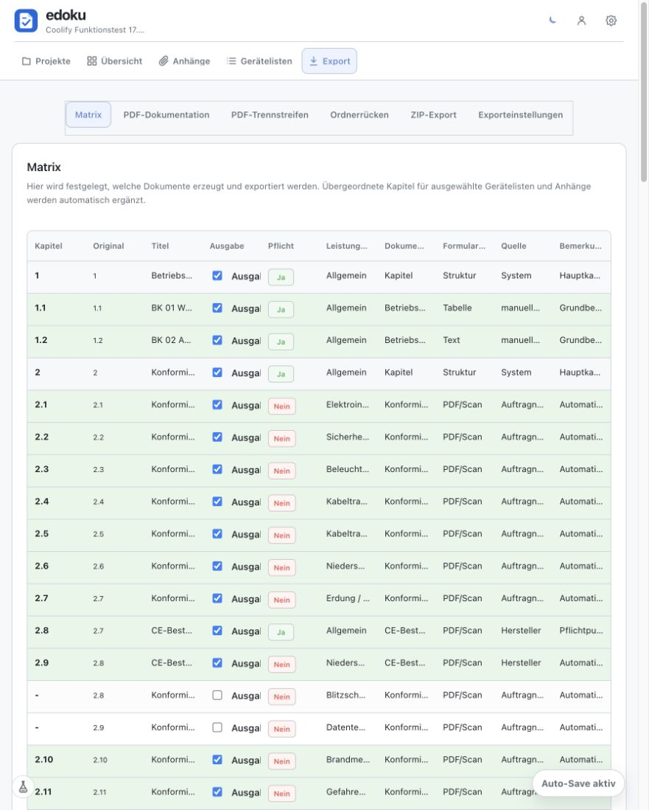

**Kapitel** ist die aktuelle Ausgabenummer; **Original** bezeichnet die ursprüngliche Vorlagenzuordnung. Kapitelüberschriften ohne eigene Datei sind Struktur, keine zusätzlichen Einzel-PDFs. Nach Änderungen des Umfangs die PDFs neu erzeugen und die Exportliste erneut prüfen.

## 6. Gerätelisten bearbeiten

1. **Gerätelisten** öffnen und links beziehungsweise in der Bereichsauswahl den passenden Leistungsbereich wählen.
2. Die Positionen des tatsächlichen Bestands erfassen: Hersteller, System, Typ, Beschreibung und die für die Liste benötigten technischen Angaben.
3. Nur tatsächlich optionale Felder leer lassen. Vorhandene Musterpositionen fachlich prüfen und entsprechend bearbeiten.
4. Falls erforderlich weitere Positionen hinzufügen. Eine einzelne Position über den zugehörigen Papierkorb entfernen; zuvor die richtige Zeile prüfen.
5. Nach der Speicherbestätigung in der PDF-Vorschau die ausgegebene Liste kontrollieren.

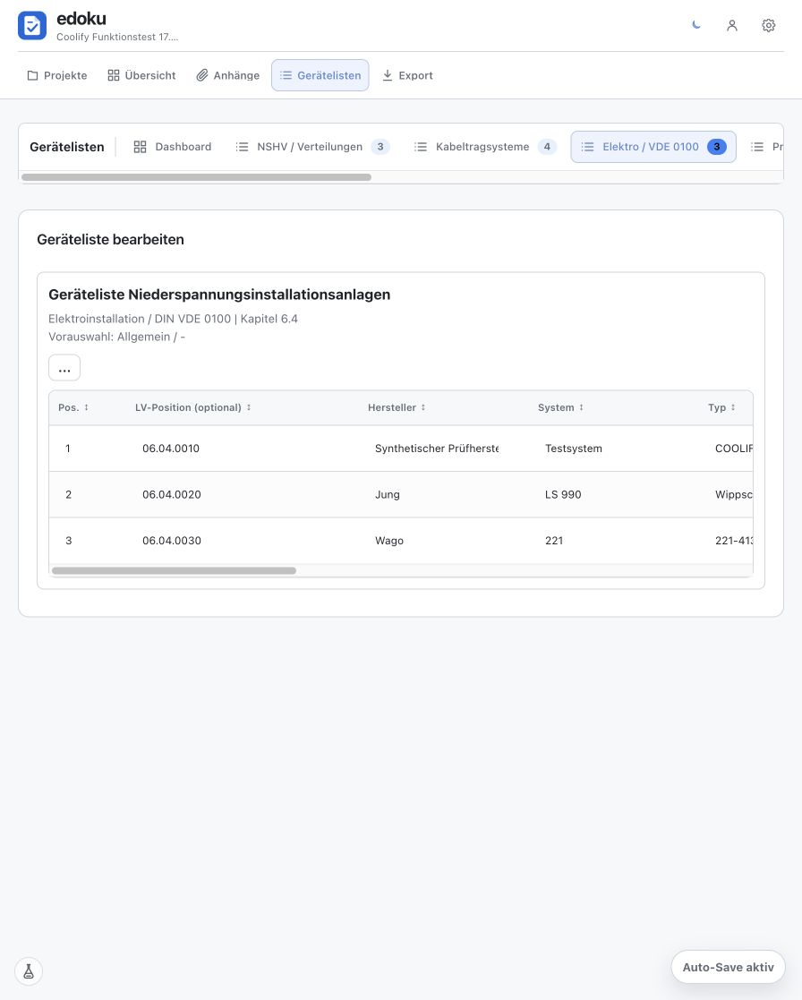

**Bedienungsanleitung zuordnen:** Die passende PDF unter **Anhänge → Bedienungsanleitungen** importieren. Danach in der Gerätezeile die Anleitung auswählen. Das **Plus** neben der Auswahl führt zum passenden Anhangsbereich. Zuordnung und späteren Kapitelverweis in der PDF prüfen; eine verfügbare Auswahl allein bestätigt noch keine passende Anleitung.

**Vorlagen:** Das Drei-Punkte-Menü bietet Werkzeuge für die jeweilige Liste. Vorlagen bewusst verwenden und die vorhandenen Positionen vorher prüfen, da das Laden einer Vorlage Positionen ersetzen kann. Globale Vorlagen verwaltet der Systemadmin.

## 7. Anhänge und Nachweise verwalten

1. **Anhänge** öffnen und zuerst die passende Kategorie wählen, etwa Stromlaufpläne, Messprotokolle, Bedienungsanleitungen oder Nachweise.
2. Über **Datei** die gewünschte Datei auswählen und **Importieren** öffnen.
3. Im Importdialog Titel und die angebotenen Zuordnungen prüfen. Mit **Import speichern** abschließen.
4. Die Datei in der Liste beziehungsweise Kachelansicht wiederfinden. Über **Bearbeiten** Metadaten und Zuordnungen ergänzen; über **Vorschau** den tatsächlichen Inhalt ansehen.
5. Bei PDF-Anhängen anschließend in Matrix und Export prüfen, ob sie an der richtigen Stelle aufgenommen werden.

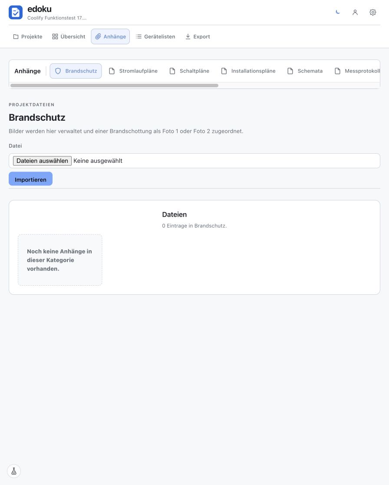

Die Aufnahme zeigt eine leere Kategorie des Testprojekts. Im eigenen Projekt erscheinen importierte Dateien als Einträge. Dateiname und Titel allein beweisen nicht, dass die richtige Revision oder der richtige Plan ausgewählt wurde.

**Brandschutzbilder** gehören in die Kategorie **Brandschutz**. Die Zuordnung zu einer Schottung und zu Foto 1 oder Foto 2 erfolgt im Bearbeitungsdialog. Bereits belegte Fotoplätze anderer Anhänge sind nicht frei verfügbar.

## 8. Brandschutz dokumentieren

1. Den Leistungsbereich **Brandschutzabschottungen** auswählen, wenn er zum Auftrag gehört.
2. Unter **Übersicht → Arbeitsschritte → Brandschutz prüfen** die Fachseite öffnen.
3. Mit **Brandschottung hinzufügen** einen Eintrag anlegen beziehungsweise einen vorhandenen bearbeiten.
4. Geschoss, Raum, Bauteil, Abschottungssystem, Hersteller, Zulassung, Feuerwiderstand und weitere erforderliche Angaben erfassen. **Aktiv** kennzeichnet berücksichtigte Schottungen.
5. Unter **Anhänge → Brandschutz** die passenden Fotos importieren und der richtigen Schottung als Foto 1 beziehungsweise Foto 2 zuordnen.
6. Warnungen prüfen und die Brandschutz-PDF neu erzeugen.

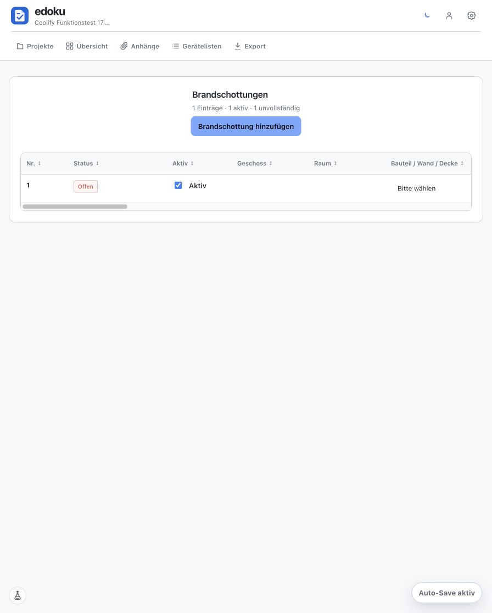

Ein eingetragener Verweis auf ein fehlendes oder nicht zugreifbares Foto erzeugt eine Warnung. Die Meldung nennt das betroffene Fotofeld; sie zählt Fotoverweise, nicht PDF-Seiten. Ein leeres optionales Fotofeld erzeugt keine solche Dateiwarnung. Ob ein Foto fachlich erforderlich ist und die richtige Ausführung zeigt, muss weiterhin verantwortlich geprüft werden. Im Screenshot ist der Beispielseintrag noch nicht ausgefüllt.

Fehlende Bilder nachliefern und zuordnen; einen berechtigten Hinweis nicht durch Entfernen des Verweises verdecken. Mehr dazu: [Brandschutzfotos prüfen](BRANDSCHUTZFOTOS.md).

## 9. PDF-Dokumentation erzeugen und prüfen

1. **Export → PDF-Dokumentation** öffnen.
2. Mit **Alles generieren** die internen Dokumente neu erzeugen. Einzelaktionen für Inhaltsverzeichnis, Formulare, Gerätelisten und Brandschutz stehen zusätzlich zur Verfügung.
3. Im **Inhaltsbaum** eine Datei auswählen und die Vorschau prüfen.
4. Projektkopf, Kapitel, Geräteangaben, Fotos, Textumbrüche und Anlagen kontrollieren.
5. Nach Änderungen an Quelldaten erneut erzeugen. Bereits vorhandene PDFs ändern sich durch einen reinen Seitenaufruf nicht.

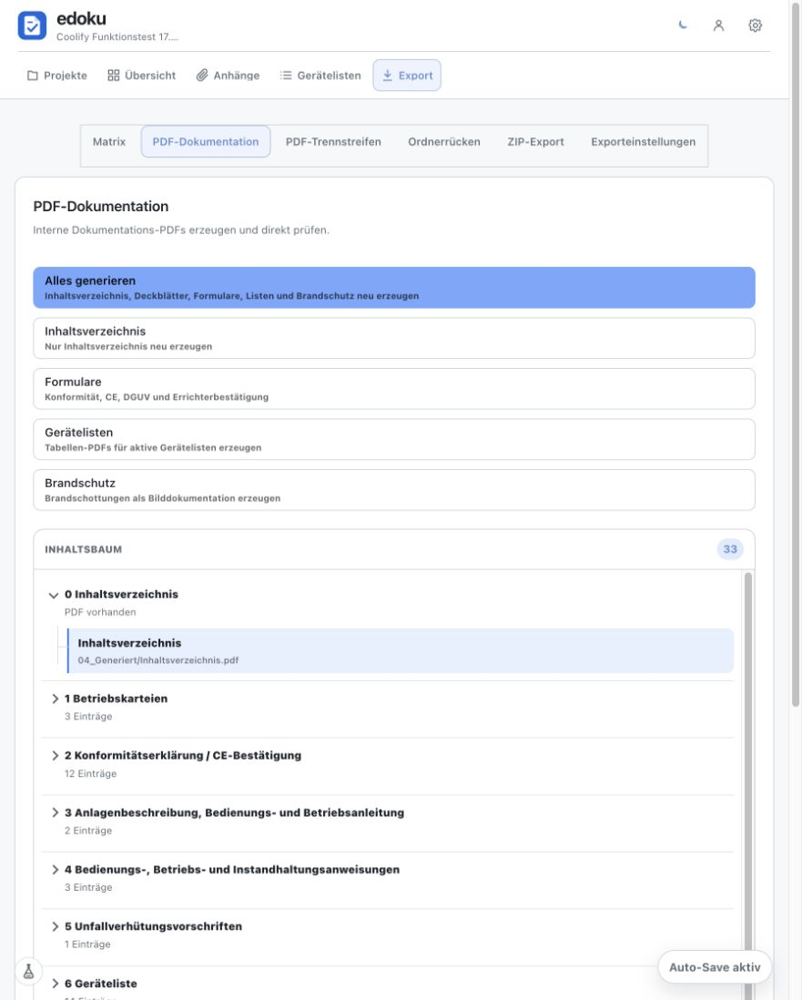

**Alles generieren** erzeugt interne Dokumente. Externe Messprotokolle, Pläne oder andere manuelle Nachweise müssen trotzdem bereitgestellt werden. Die erzeugten Formulartexte benötigen eine fachliche Prüfung.

## 10. Gesamt-PDF und ZIP erstellen

### Zuerst den Umfang prüfen

Unter **Export → Exporteinstellungen** die vorhandenen und fehlenden Dateien prüfen. **Exportliste prüfen** aktualisiert Reihenfolge und Dateistatus; es beschafft keine fehlenden Unterlagen.

| Anzeige | Bedeutung |
| --- | --- |
| Geplante Einzel-PDFs | Für den ausgewählten Umfang erwartete PDF-Dateien |
| Vorhandene Einzel-PDFs | Tatsächlich verfügbare Einzeldateien |
| Fehlende Einzel-PDFs | Geplante, aber nicht vorhandene Dateien |
| Fehlerhaft / veraltet | Dateien, die geprüft beziehungsweise neu erzeugt werden müssen |
| Fehlende Pflicht | Noch fehlende als Pflicht gekennzeichnete Unterlagen |
| Vorhandene PDF-Seiten | Tatsächliche Seiten der vorhandenen PDFs; eine mehrseitige Datei zählt entsprechend |
| Strukturüberschriften | Gliederungseinträge ohne eigene PDF-Datei |

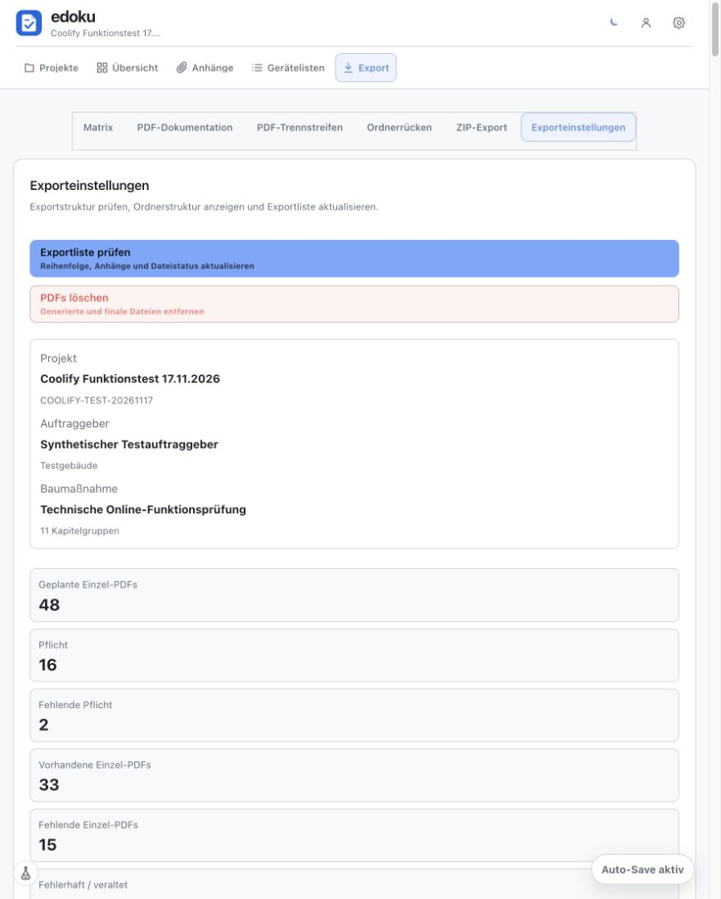

Gesamt-PDF und separate Druckhilfen erhöhen den Zähler für Einzel-PDFs nicht zusätzlich. Im Beispiel bestehen **33 Einzel-PDFs aus 35 Seiten**; die Zahlen sind deshalb unterschiedlich.

### Danach die Ausgabe erstellen

1. **Export → ZIP-Export** öffnen.
2. **Finalen Export vorbereiten** auswählen. Interne Dokumente werden aktualisiert; Gesamt-PDF, ZIP und Reihenfolgeprotokoll werden erstellt.
3. Die Ergebnisnachricht lesen. Bei **Unvollständiger Export** die genannten Dateien oder Fotos ergänzen beziehungsweise Zuordnungen korrigieren und erneut erzeugen.
4. Gesamt-PDF über **Vorschau** kontrollieren. Die benötigten Dateien über **Download** herunterladen.
5. In **EXPORT_REIHENFOLGE.txt** die Reihenfolge und Hinweise auf ausgelassene oder fehlende Quellen prüfen.

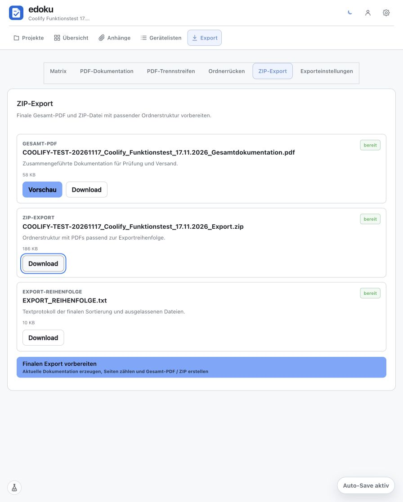

**„Bereit“ beschreibt die Verfügbarkeit der Datei. Es bedeutet nicht, dass die Dokumentation vollständig ist.** Im gezeigten Testprojekt wurden Gesamt-PDF und ZIP erstellt, obwohl 15 geplante PDF-Dateien fehlen. Das Ergebnis ist ein Teilstand und darf nicht als vollständig freigegeben werden. Verbindlich sind auch die Exportmeldung, die Dateiprüfung und das Reihenfolgeprotokoll.

## 11. Trennstreifen und Ordnerrücken drucken

### Trennstreifen

Unter **Export → PDF-Trennstreifen** die gewünschten Titeloptionen einstellen und **Trennstreifen erzeugen** wählen. Die Registerstreifen sind für **24 × 10,5 cm** vorgesehen und werden separat erzeugt. Vor einer größeren Serie einen Ausdruck in tatsächlicher Größe prüfen.

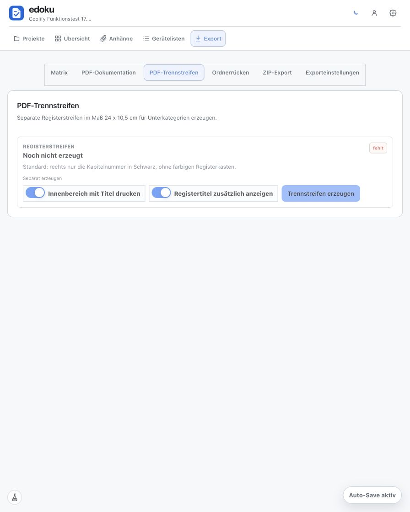

### Ordnerrücken

1. **Export → Ordnerrücken** öffnen.
2. Zum vorhandenen Etikettenbogen **Avery Zweckform 61x192-R** oder **38x192-R** wählen.
3. Anzahl manuell festlegen oder **Nach PDF-Seiten** auswählen.
4. Bei automatischer Berechnung den Wert **PDF-Seiten je Ordner** passend zur tatsächlichen Ablage setzen; Standard ist 80.
5. Gewünschte bedruckte Bereiche auswählen, **Ordnerrücken erzeugen** wählen und einen Probeausdruck prüfen.

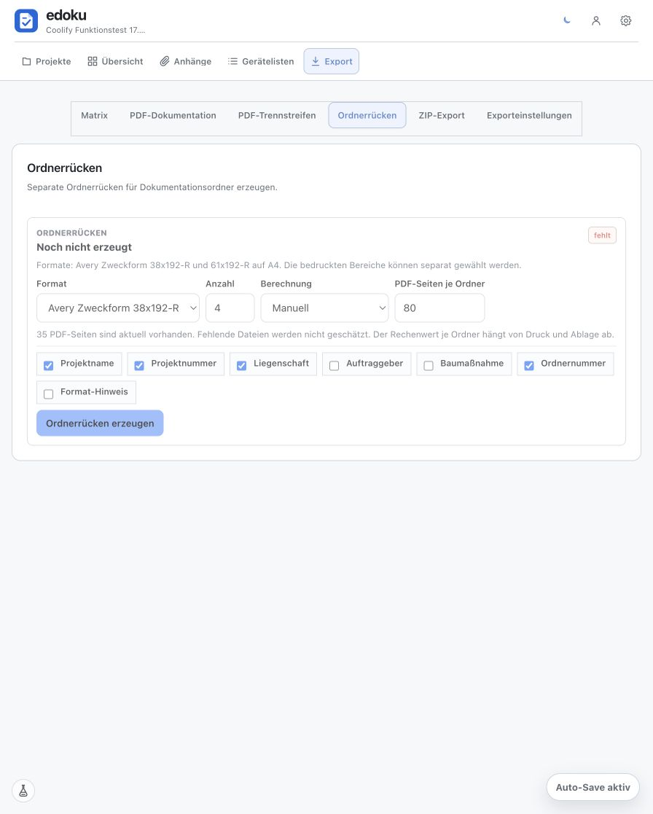

Die automatische Anzahl berücksichtigt vorhandene PDF-Seiten. Fehlende Dateien werden nicht geschätzt. Papier, ein-/beidseitiger Druck und tatsächliche Ordnerkapazität können die benötigte Anzahl verändern. Trennstreifen und Ordnerrücken sind eigenständige Druckhilfen.

## 12. Projektpakete und Archiv verwenden

### Drei unterschiedliche Zwecke

| Du möchtest … | Verwende … |
| --- | --- |
| Die erzeugte Dokumentation an jemanden weitergeben | Gesamt-PDF und Dokumentations-ZIP unter Export |
| Ein bearbeitbares Projekt übertragen | Projektpaket unter Projekte → Import / Pakete |
| Alle Projekte, Konten, Einstellungen und historische Dateien absichern | Eine vollständige Sicherung durch die zuständige Administration |

### Projektpaket erstellen

1. Das richtige Projekt öffnen und **Projekte → Import / Pakete** aufrufen.
2. Festlegen, ob Uploads, generierte PDFs und finale PDFs enthalten sein sollen. Für eine ZIP-Datei **ZIP-Datei erzeugen** aktiv lassen.
3. **Projekt exportieren** wählen.
4. Den Eintrag unter **Letzte Exporte** prüfen und Manifest beziehungsweise ZIP herunterladen.
5. Hinweise auf fehlende Quellen oder separat aufbewahrte historische Ausgaben beachten. Ein Paket kann trotz vorhandener ZIP unvollständige Quellen enthalten.

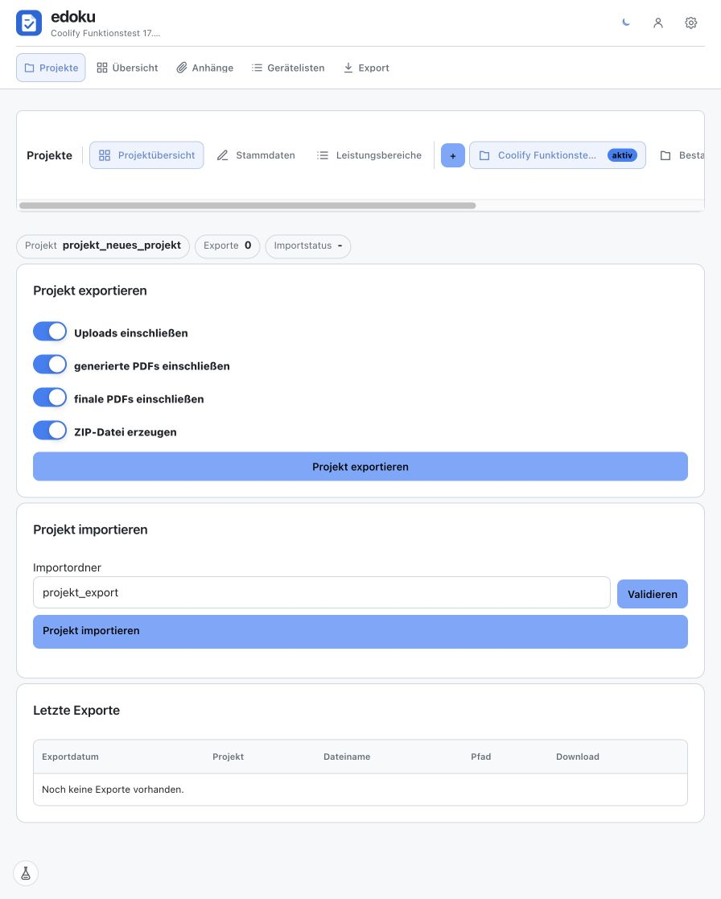

### Projektpaket importieren

Der zuständige Administrator muss das entpackte Paket zuerst im vorgesehenen Importbereich deines Kontos bereitstellen. Der Bildschirm ist **kein ZIP-Upload**.

1. Unter **Importordner** den bereitgestellten Paketnamen eingeben.
2. **Validieren** wählen und alle Hinweise lesen.
3. Nur bei passendem Prüfergebnis **Projekt importieren** wählen.
4. Das importierte Projekt öffnen und Stammdaten, Anhänge, Fotos und Exporte kontrollieren.

Bei bereits vorhandener Projektkennung entsteht eine neue Kennung; vorhandene Projekte werden nicht überschrieben. Das Paket enthält keine Konten oder Passwörter und ersetzt keine vollständige Sicherung. Details zum Verfahren stehen unter [Projektarchive](PROJEKTARCHIVE.md).

### Archivstatus

Unter **Projekte → Archiv** findest du archivierte beziehungsweise als gelöscht markierte Projekte. Dieser Status ist von einem exportierten Projektpaket zu unterscheiden. Die Anwendung beschreibt gelöschte Projekte als Statusmarkierung; für die Datensicherung trotzdem ein geeignetes Paket beziehungsweise eine Vollsicherung verwenden.

## 13. Darstellung und Einstellungen

Für den schnellen Wechsel zwischen heller und dunkler Darstellung das **Mond-/Sonnensymbol** im Kopfbereich verwenden.

Unter **Einstellungen → Theme** stehen Presets und eigene Farb-, Größen- und Formwerte zur Verfügung. Eigene Änderungen mit **Theme speichern** bestätigen. **Zurücksetzen** und Preset-Wechsel bewusst verwenden, da sie eigene Darstellungswerte ersetzen können.

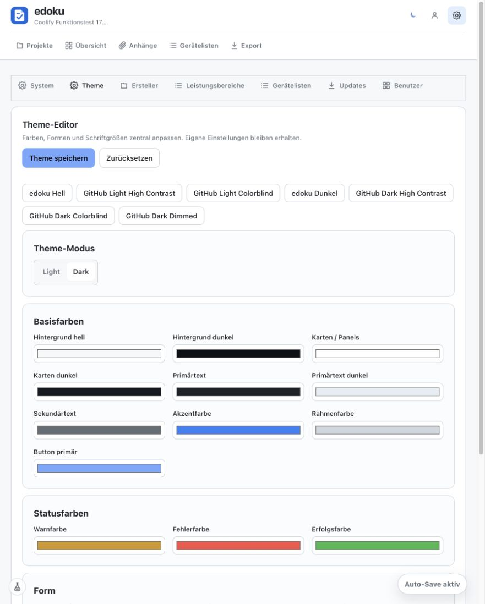

Globale Einstellungen, Vorlagen und Erstellerangaben gelten nicht zwingend nur für das aktuell geöffnete Projekt. Diese Änderungen mit dem zuständigen Systemadmin abstimmen.

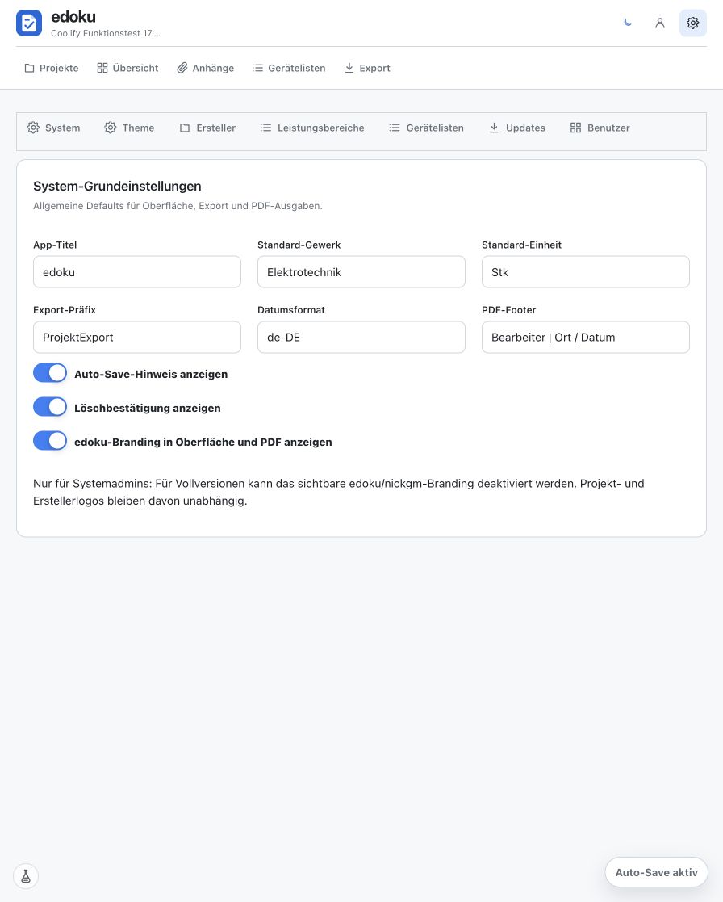

## 14. Konten und Rollen verstehen

| Rolle | Möglichkeiten |
| --- | --- |
| Nur lesen | Eigene Projekte und vorhandene Dateien ansehen |
| Benutzer | Eigene Projekte bearbeiten, Unterlagen und Pakete erzeugen oder importieren |
| Systemadmin | Zusätzlich Konten, globale Einstellungen und Vorlagen verwalten |

Welche Schaltflächen verfügbar sind, hängt von der Rolle ab. Systemadmin-Rechte bedeuten keinen direkten Zugriff auf die Projektdateien anderer Konten.

Neue Konten und Passwortprobleme bearbeitet der Systemadmin unter **Einstellungen → Benutzer**. Neue Passwörter benötigen mindestens 12 Zeichen. Ein erfolgreicher Passwortreset beendet vorhandene Anmeldungen des betroffenen Kontos. Ein eigener Passwortwechsel für normale Benutzer ist derzeit noch nicht vorgesehen.

Die Selbstregistrierung ist standardmäßig geschlossen. Sie wird nicht für die normale Nutzung eines zugewiesenen Kontos benötigt. Nach der Arbeit auf gemeinsam genutzten Geräten über das Benutzermenü abmelden. Details für Kontoverantwortliche: [Benutzerverwaltung](BENUTZERVERWALTUNG.md).

## 15. Häufige Fragen und Fehlermeldungen

| Beobachtung | Bedeutung und nächster Schritt |
| --- | --- |
| „Unvollständiger Export“, obwohl PDF und ZIP bereitstehen | Die Dateien existieren, aber Quellen fehlen oder wurden nicht übernommen. Exporteinstellungen und Reihenfolgeprotokoll prüfen, Unterlagen ergänzen, erneut erzeugen. |
| „Brandschutz-Fotoverweis … fehlt“ | Eingetragene Fotodatei ist nicht erreichbar. Richtige Datei nachliefern und der betroffenen Schottung zuordnen; anschließend PDFs neu erzeugen. |
| 100 % oder „Bearbeitet“, aber Inhalt ist fachlich falsch | Die Anzeige bewertet hinterlegte Angaben beziehungsweise den Arbeitsstand. Inhalte und Nachweise separat prüfen. |
| Änderung wird nicht gespeichert | Meldung lesen und Eingaben zunächst erhalten. Verbindung und Anmeldung prüfen; fehlgeschlagene Änderungen nicht als gespeichert behandeln. |
| Konflikt oder veralteter Bearbeitungsstand | In einem anderen Fenster wurde zwischenzeitlich gespeichert. Eigene offene Eingaben notieren, aktuellen Stand laden und Änderungen bewusst zusammenführen. |
| Eine PDF zeigt alte Angaben | Nach der Speicherbestätigung die passende PDF beziehungsweise den finalen Export erneut erzeugen. |
| Datei erscheint im falschen Kapitel oder fehlt | Kategorie, Geräte-/Schottungszuordnung, Leistungsbereich und Matrixauswahl prüfen. Danach Exportliste aktualisieren. |
| Die Anleitung eines Geräts ist nicht auswählbar | PDF unter Anhänge → Bedienungsanleitungen importieren; dann die richtige Gerätezeile öffnen und Zuordnung prüfen. |
| Geräteliste oder Fachbereich fehlt | Zuerst aktives Projekt und dessen gewählte Leistungsbereiche prüfen. |
| Tabellenfelder sind abgeschnitten | Im Tabellenbereich horizontal scrollen; gegebenenfalls ein breiteres Browserfenster verwenden. |
| Bearbeiten ist nicht möglich | Aktives Konto und Rolle prüfen; bei „Nur lesen“ den Systemadmin ansprechen. |
| Passwort vergessen | Den zuständigen Systemadmin um einen Reset bitten. |
| Import erwartet einen Ordner statt einer ZIP | Entpacktes Paket durch die Administration bereitstellen lassen, Paketnamen eingeben, validieren und anschließend importieren. |

## 16. Checkliste vor der Weitergabe

- Richtiges Projekt und richtige Projektnummer ausgewählt.
- Musterangaben ersetzt; Auftraggeber, Objekt, Bearbeiter und Datum geprüft.
- Leistungsbereiche und Ausgabeumfang entsprechen dem tatsächlichen Auftrag.
- Geräte, Pläne, Nachweise und Brandschutzbilder passen zum Bestand.
- Fehlende Pflichtunterlagen und Dateiwarnungen geklärt.
- PDFs nach der letzten Änderung neu erzeugt und inhaltlich geprüft.
- Kapitel, Reihenfolge, Seiten und Gesamt-PDF kontrolliert.
- Exportmeldung und Reihenfolgeprotokoll gelesen; Teilstände ausdrücklich gekennzeichnet.
- Fachlich verantwortliche Person hat die Dokumentation geprüft und freigegeben.
- Benötigte Ausgaben gesichert beziehungsweise übergeben.

[Zurück zur Projektübersicht im README](../README.md) · [Weitere Dokumentation](README.md)
