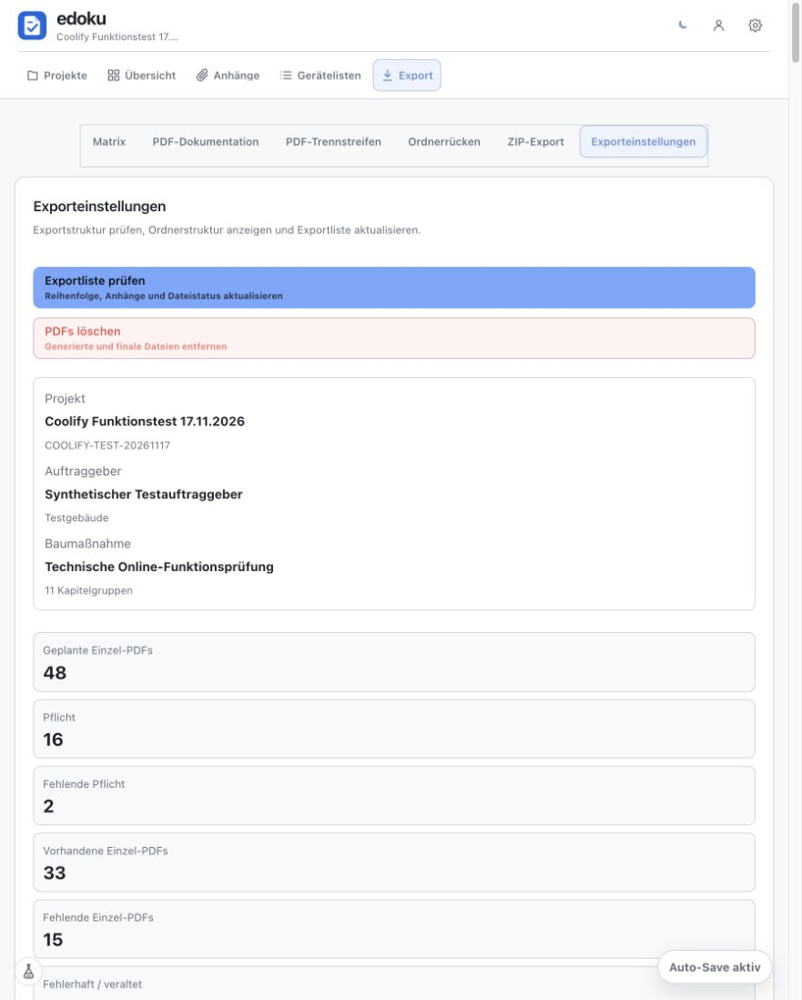

# Technischer Online-Prüfstand

Stand: **17.11.2026**. Diese Seite dokumentiert die tatsächlich geprüfte Testbereitstellung. Sie ist ein technischer Nachweis; die reine Nutzung erklärt die [Bedienungsanleitung](BEDIENUNGSANLEITUNG.md).

## Version und Veröffentlichung

| Gegenstand | Stand |
| --- | --- |
| Paketversion | `0.1.0-beta.1`, kein neuer Release-Tag |
| Geprüfter Programmbranch | `gm/coolify-test-20261117` |
| Online verwendeter Programmcommit | [`a07104ba18c0cb1ea0d7958ebc32504c47bd002e`](https://github.com/loserat/edoku/commit/a07104ba18c0cb1ea0d7958ebc32504c47bd002e) |
| Bereitstellung | Erfolgreich am 17.11.2026, 17:09:23 UTC; Status `healthy` beobachtet |
| Dokumentationsänderungen | Eigenständige Folgeschritte; ändern den festgesetzten Online-Programmcommit nicht |
| Hauptbranch | Geprüfter Programmstand einschließlich Dokumentation in `main` übernommen; laufende Installationen bleiben davon getrennt |

Die Online-Testinstanz durfte mit ausdrücklich freigegebenem frischem Bestand eingerichtet werden. Dies galt ausschließlich für diese Testinstanz. Lokale Originalprojekte, Konten, Passwortdaten, Sicherungen und historische Dateien wurden nicht ersetzt.

## Tatsächlich verifiziert

| Bereich | Beobachtung | Grenze |
| --- | --- | --- |
| HTTPS | Gültige TLS-Prüfung ohne Ausnahme; HTTP leitet nach HTTPS | Datiert, keine dauerhafte Überwachung |
| Bereitschaft | `/ready` HTTP 200, `status=ready`, `storage=sqlite`, `deviceProjection=true` | Keine vollständige Datenbank- oder fachliche Integritätsprüfung |
| Zugriffsgrenze | Projektseite ohne Anmeldung leitet zum Login | Ergänzt automatisierte Zugriffstests, ersetzt keinen Penetrationstest |
| Anmeldung | Eigener Erstzugang funktioniert; Benutzer hat die Anmeldung bestätigt | Passwort selbst eingegeben, nicht veröffentlicht |
| Projekt | Künstliches Projekt angelegt, Stammdaten gespeichert und nach Neuladen wieder sichtbar | Keine Schreibprüfung mit lokalen Originalen |
| Geräte | Hersteller, System und Typ einer Testposition geändert und nach Neuladen geprüft | Technischer Speicherablauf, keine Prüfung realer Bestandsgeräte |
| Containerwechsel | Anmeldung, Testprojekt und gespeicherte Änderungen überstanden das nachfolgende Sicherheits-Deployment | Kein simulierter kompletter Serverausfall |
| PDFs | Interne Dokumentation erzeugt, 33 Dateien im Inhaltsbaum sichtbar | Fachlich unvollständiger Testbestand |
| Finaler Export | Gesamt-PDF, ZIP und Reihenfolgeprotokoll erstellt und als bereit angezeigt | 15 geplante PDF-Dateien fehlen; kein vollständiger Dokumentationsabschluss |
| Download | Nicht unabhängig verifiziert | Browserfreigabe für den ZIP-Download wurde abgelehnt; keine Umgehung |

## Den Exportbefund richtig lesen

Das Testprojekt enthält **48 geplante Einzel-PDFs, 33 vorhandene Einzel-PDFs und 35 tatsächliche Seiten**. **15 PDF-Dateien fehlen oder konnten nicht übernommen werden**, darunter zwei als Pflicht markierte Dokumente. Die Anwendung meldete deshalb **Unvollständiger Export**. Gesamt-PDF und ZIP wurden als Teilstand erstellt.

Die Kennzeichnung **bereit** an der Dateikarte bedeutet lediglich, dass diese Datei existiert und angeboten wird. Sie ist kein Vollständigkeits- oder Freigabestatus. Fehlende Unterlagen werden nicht automatisch erstellt, nur weil ein Export ausführbar ist. Die Warnung ist bei diesem künstlichen Projekt ein erwarteter fachlicher Befund; sie wurde nicht durch Abwählen benötigter Dokumente verdeckt.

Die lokal automatisierten Exporttests prüfen Zählung, Zusammenführung und ZIP-Inhalte in kontrollierten Fällen. Der konkrete Online-Download wurde in dieser Runde nicht zusätzlich auf Dateiinhalte und Seitenzählung geprüft. Eine vollständige fachliche Abnahme folgt daraus nicht.

## Automatisierte und lokale Nachweise

- **109 bestandene Prüfungen:** 101 Node.js und acht Python im neuen Node-22-Abbild; nach Paketkorrekturen erneut vollständig bestanden.
- **Paketprüfung am 17.11.2026:** `npm audit --omit=dev` meldete null bekannte Lücken im gesperrten Paketstand. Keine allgemeine Sicherheitsgarantie.
- **Getrennte lokale Compose-Probe:** Neuinstallation und Container-Neuerstellung erfolgreich; fünf Testvolumes, Datenbankinhalte und eigener Erstzugang erhalten.
- **Mac-Bestandsschutz:** 758 lokale Bestandsdateien sowie Schema und Inhalte aller neun SQLite-Tabellen gegenüber dem Ausgangsstand unverändert. Der normale lokale Container blieb auf seinem vorherigen Programmabbild.
- **Bereinigung:** Nur die neu angelegte synthetische lokale Testumgebung und ihr temporärer Quellordner nach Archivierung entfernt. Sicherungen und historische Bestände erhalten.

Die privaten Detailnachweise, Laufzeitarchive und Datenbankprüfsummen bleiben außerhalb von GitHub. Ein lokaler Testlauf ist kein GitHub-CI-Lauf; für den genannten Programmcommit wird hier kein neuer erfolgreicher CI-Lauf behauptet.

## Bedienungsanleitung auf GitHub geprüft

Die veröffentlichte Anleitung wurde am 17.11.2026 zusätzlich direkt in der GitHub-Vorschau geprüft: Alle 16 Screenshots vollständig geladen, alle 16 Kapitelziele des Inhaltsverzeichnisses vorhanden, Sprung zu einem Kapitel und dessen eingebettetes Bild visuell bestätigt. Der frühere GitHub-Dateiansichtsfehler trat dabei nicht mehr auf. Diese reine Dokumentationsprüfung änderte keine App-Daten.

## Offen

Fachliche Vollständigkeit der Unterlagen, konkrete Online-Downloadprüfung, physische Druckabnahme, externe Sicherungsorganisation und regelmäßige Wiederherstellungsproben sowie weitergehende Sicherheits-, Browser- und Barrierefreiheitsabnahme bleiben getrennte Aufgaben. Siehe [Offene Punkte](OFFENE_PUNKTE.md).

[Technischer Betrieb](COOLIFY.md) · [Prüfumfang](TESTS.md) · [Aktueller Stand](AKTUELLER_STAND.md)
