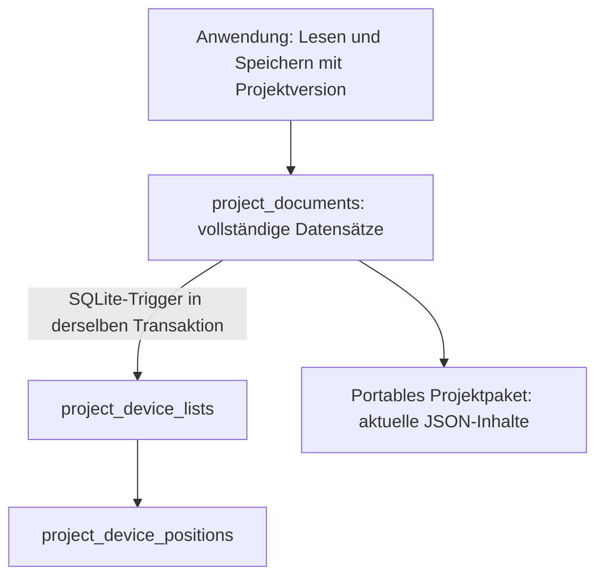

# SQLite-Projektdaten – Stufen 1 und 2

Stand: 06.11.2026

## Führender Speicher

Nach der geprüften Aktivierung liegen alle neun projektbezogenen Datensätze in `storage/app.db`: Stammdaten, Leistungsbereiche, Systemauswahl, Dokumentenmatrix, Gerätelisten, Brandschutz, Anhangsmetadaten, Exportliste und Dateimetadaten. Fotos, Anhänge, PDFs und ZIPs bleiben Dateien. Globale Einstellungen, Vorlagen und Ausgangsdaten bleiben dateibasiert.

Stufe 1 übernimmt die bisherigen Objekt-/Listenstrukturen vollständig als JSON-Datensätze in SQLite. Unbekannte Felder, individuelle Listenspalten und Reihenfolgen bleiben bei dieser Übernahme erhalten. Stufe 2 ergänzt daraus einzelne Geräte-/Positionszeilen als synchronisierte Projektion; der vollständige Datensatz bleibt auch danach führend.

Die Tabellen `project_storage`, `project_data_revisions` und `project_documents` ergänzen die vorhandene Datenbank. Konten, Passwort-Hashes/Salts, Sitzungen und das Projektregister werden durch die Übernahme nicht umgeschrieben. Jede Dokumentzeile gehört über Fremdschlüssel eindeutig zu Benutzer und Projekt.

Die ursprünglichen JSON-Dateien bleiben als Ausgangskopie unverändert erhalten. Nach Aktivierung liest und schreibt die Anwendung die erfassten Datensätze ausschließlich in SQLite; direkte Änderungen der alten JSON-Dateien wirken deshalb nicht mehr in der Anwendung. Sie sind kein aktueller Spiegel. SQLite-Fehler führen zu einem sichtbaren Fehler, nicht zu einem stillen Rückfall auf alte Daten. Die Datenbank gehört zwingend zur Sicherung.

## Datenmodell

| Tabelle | Aufgabe |
| --- | --- |
| `users`, `sessions`, `projects` | Vorhandene Konten, Sitzungen und benutzergebundenes Projektregister |
| `project_storage` | Aktivierung und unterstützte Version der vollständigen Projektdaten |
| `project_data_revisions` | Gemeinsamer Versionsstand je Benutzer/Projekt |
| `project_documents` | Neun aktuelle vollständige Datensätze, Dokumentrevision, Herkunfts-JSON, Herkunftsprüfsumme und Zeitstempel |
| `project_device_storage` | Version der zusätzlichen Geräteprojektion |
| `project_device_lists` | Listen in ursprünglicher Reihenfolge, Listenfelder und verbleibende individuelle Angaben |
| `project_device_positions` | Positionen je Liste in ursprünglicher Reihenfolge und ihre Felder |

Die neun Dokumentnamen sind `projekt.json`, `leistungsbereiche.json`, `projektSysteme.json`, `dokumentenmatrix.json`, `geraetelisten.json`, `brandschutz.json`, `anhaenge.json`, `exportliste.json` und `files.json`. Die Namen bleiben für Anwendung und portable Projektpakete kompatibel; sie bedeuten nach Aktivierung keinen führenden Dateispeicher.



`source_json` und `source_sha256` dokumentieren den ursprünglichen Übernahmestand. `payload` enthält den aktuellen Inhalt. Benutzer- und Projektkennungen bilden gemeinsam die Zuordnung; gleiche sichtbare Namen oder gleiche fachliche Listen-IDs sind keine gemeinsame Ablage.

## Stufe 2: Gerätelisten und Positionen

`project_device_lists` und `project_device_positions` bilden Listen und ihre Positionen in einzelnen, projekt- und benutzergebundenen Zeilen ab. Felder wie Leistungsbereich, Kapitel, Hersteller, Typ und LV-Position sind direkt per SQL abfragbar. Indizes unterstützen die Abfrage je Benutzer und Projekt sowie nach Leistungsbereich und Gerätetyp.

Diese Stufe ist bewusst eine **relationale Projektion**: Der vollständige Datensatz in `project_documents` bleibt führend und portabel. Es gibt keinen zweiten unabhängig beschreibbaren Anwendungsspeicher. SQLite-Trigger aktualisieren die Tabellen innerhalb derselben Transaktion, auch wenn noch ein Programm der ersten SQLite-Stufe schreibt. Eine fehlgeschlagene Positionsübernahme nimmt die gesamte Speicherung einschließlich Projektversion und Metadaten zurück. Direkte manuelle Änderungen an den Projektionstabellen sind nicht vorgesehen; Abweichungen werden beim Lesen und vor dem JSON-Rückweg als Fehler gemeldet.

Listenreihenfolge und Positionsreihenfolge werden separat gespeichert. Fachliche IDs und Positionsnummern müssen nicht eindeutig sein und werden unverändert übernommen. Individuelle Felder bleiben in den zeilenbezogenen JSON-Daten erhalten; Positionsarrays werden aus der Listenzeile herausgelöst. Ältere flache Listen, leere Listen und ungewöhnliche JSON-Werte werden nicht fachlich umgedeutet oder bereinigt. Nichtlisten bleiben im vollständigen Projektdatensatz und erzeugen keine Gerätezeilen. Die Migration liest ausschließlich aktuelle SQLite-Daten; ursprüngliche JSON-Ausgangsdateien, Dokumentrevisionen, Projektversionen und Zeitstempel werden nicht umgeschrieben.

```bash
npm run storage:devices -- --root /pfad/zur/getrennten/installation
npm run storage:status -- --root /pfad/zur/getrennten/installation
```

Bestehende SQLite-Installationen aktivieren diese Ergänzung ausdrücklich, zunächst auf Kopien und nach Vollsicherung bei angehaltener Anwendung. Die Übernahme und Prüfung aller Zeilen erfolgt in einer Transaktion; eine Wiederholung prüft vorhandene Tabellen, ohne neuere Daten zu ersetzen. `project_device_storage` kennzeichnet die unterstützte Version. Neue Installationen aktivieren beide Stufen; neue und importierte Projekte erhalten automatisch ihre Gerätezeilen.

Für einen Rückweg auf Stufe 1 bleiben die vollständigen Datensätze aktuell und die Trigger weiter wirksam. Für einen älteren JSON-Programmstand gilt weiterhin der unten beschriebene Rückweg ausschließlich in einen neuen Ordner. Eine echte führende Speicherung einzelner Gerätefelder sowie entsprechende Tabellen für Brandschutz und Anhänge bleiben weitere Ausbaustufen.

## Aktivierung

Die folgende Anleitung gilt für den aktuellen Programmstand. Die normale lokale Anwendung wurde am 06.11.2026 nach Kopientests, Vollsicherung und ausdrücklicher Freigabe auf beide Stufen umgestellt. Das aktiviert keine andere Installation automatisch.

Vorhandene Installationen werden ausdrücklich und nach Sicherung umgestellt. Bloßes Starten einer neuen Programmversion aktiviert die Übernahme nicht. Neuinstallationen verwenden die SQLite-Ablage; Projektdateien werden beim ersten Einrichten des jeweiligen Projekts erfasst.

```bash
npm run storage:status
npm run storage:migrate -- --root /pfad/zur/getrennten/installation
```

Für Docker enthält [Update und Datensicherung](UPDATE.md#sqlite-stufen-bewusst-aktivieren) die entsprechenden Befehle im geprüften Abbild. `storage:status` zeigt den aktiven Projektmodus sowie `devices.active`, Version, Listen- und Positionszahl der Geräteprojektion. Ein fehlendes `devices.active` im Ergebnis eines älteren Programms ist kein Beleg für Stufe 2.

Die Migration muss bei angehaltener Anwendung und zunächst auf Kopien erfolgen. Sie liest und prüft alle neun Quelldateien pro registriertem Projekt, prüft deren unveränderte Prüfsummen und speichert die Übernahme einschließlich Aktivierung in einer SQLite-Transaktion. Fehlerhafte oder fehlende Daten eines vorhandenen Projekts brechen die Übernahme ab. Gelöschte Projekte ohne Datenordner dürfen als solche erhalten bleiben. Vorhandene gelöschte Projekte mit Daten werden mit übernommen.

Eine Wiederholung überschreibt keine bereits in SQLite vorhandenen neueren Daten. Die ursprünglichen Quelldaten und Prüfsummen werden zusätzlich in SQLite als Herkunftsnachweis erhalten. Vorhandene Konten oder Passwörter werden weder ersetzt noch neu gesetzt.

## Speichern und Konflikte

Ein Arbeitsvorgang liest einen konsistenten Projektstand. Änderungen mehrerer erfasster Datensätze werden zunächst gesammelt und bei Erfolg zusammen in einer Datenbanktransaktion gespeichert. Fehler brechen die ausstehenden Änderungen ab. Eine absichtlich als unvollständig gekennzeichnete, technisch erzeugte Dokumentation behält ihre berechnete Exportliste einschließlich Fehlhinweisen.

Formulare und Auto-Save senden eine Projektkennung mit Versionsstand. Ist die Seite veraltet oder wurde das aktuelle Projekt inzwischen in einem anderen Fenster gewechselt, antwortet der Server mit HTTP 409. Der Nutzer soll neu laden und seine Änderungen prüfen. Erfolgreicher Auto-Save aktualisiert den Versionsstand auf der Seite. CSRF- und Rollenprüfungen bleiben zusätzlich wirksam; die Versionsangabe ersetzt keinen Zugriffsschutz.

Die Transaktion umfasst die strukturierten Datensätze. Dateioperationen an Fotos/PDFs, globale Einstellungen und Konten sind keine gemeinsame Transaktion mit diesen Datensätzen. Die vorhandenen Rückfallebenen für Dateien bleiben erhalten.

## Historische Ausgaben und Projektpakete

Der historische Bestand unter `output/projekte/` bleibt unverändert. Seine bisherige Zuordnung wird über die ursprünglichen Projektdeskriptoren beurteilt; eine spätere Namensänderung in SQLite ordnet alte Ausgaben nicht automatisch neu zu.

Projektpakete behalten das portable Format 2.0. Ihre JSON-Dateien werden aus dem aktuellen SQLite-Stand erzeugt. Ein Rückimport legt ein neues Projekt und die zugehörigen SQLite-Datensätze an. Die Ausgangskopien anderer Projekte bleiben erhalten. Die bestehende Prüfung von Prüfsummen, Dateiverweisen und Benutzergrenzen gilt weiterhin.

## Geprüfter Rückweg nur in einen neuen Ordner

Ein altes Programmabbild darf nicht einfach gegen die unveränderten alten JSON-Ausgangskopien gestartet werden: Diese enthalten spätere SQLite-Änderungen nicht. Für einen Rückweg zuerst eine aktuelle vollständige Sicherung erstellen und prüfen. Die Wiederherstellung geschieht ausschließlich in einen neuen Ordner.

```bash
npm run storage:rollback -- --backup /pfad/zur/aktuellen/vollsicherung --destination /pfad/zum/neuen/rueckweg
```

Der Befehl nutzt die geprüfte Vollwiederherstellung, schreibt alle aktuellen SQLite-Datensätze als JSON in die neue Kopie, prüft jeden Datensatz und deaktiviert dort den SQLite-Projektmodus. Die Herkunftstabellen bleiben als Nachweis erhalten. Originalinstallation und Sicherung werden nicht überschrieben. Eine solche Rückwegkopie wird durch den einfachen Migrationsbefehl nicht wieder aktiviert: Nach späteren JSON-Änderungen wäre zunächst ein erneuter ausdrücklicher Datenabgleich erforderlich. Ein vorhandenes Ziel wird abgewiesen. Ein optionales `--legacy-image` wählt ein bekanntes früheres Abbild für die erzeugte Prüfkonfiguration; ein automatischer Austausch der Hauptanwendung erfolgt nicht. Die wiederhergestellte Anwendung und die Projekt-/Archivzuordnung müssen anschließend getrennt geprüft werden.

## Prüfungen

```bash
npm run test:storage
npm run check
npm test
```

Die vollständige Suite umfasst 103 Prüfungen (95 Node.js, acht Python); davon gehören 28 zur Speicherprüfung. Acht bestehende Projektkopien lieferten vor/nach Stufe 2 dieselben Kapitel, Exportpositionen, Fotowarnungen und 249 tatsächliche PDF-Seiten. Paketprüfung, Rückimporte, Schreiben mit der bisherigen SQLite-Version und JSON-Rückweg wurden geprüft. Nach lokaler Aktivierung wurden die Originaldaten lesend, auf Konsistenz und auf unveränderte bisherige Inhalte geprüft. Umfang und Grenzen: [Tests](TESTS.md).

Die Prüfungen verwenden künstliche Projekte oder getrennte echte Projektkopien. Sie umfassen vollständige Übernahme, unbekannte Felder, Wiederholung, fehlerhafte Quellen, transaktionalen Abbruch, parallele Änderungen, fehlende Versionen, aktuelle Archive, Rückimport und den Rückweg in eine neue Kopie. Die bisherigen Export-, Benutzer-, Sicherheits-, Archiv- und Datenerhalttests bleiben Teil der Suite. Fachlich fehlende Unterlagen oder Fotos werden durch eine Speicherumstellung nicht ergänzt.

## Noch nicht Bestandteil dieser Stufen

Die führende Speicherung einzelner Gerätefelder außerhalb des vollständigen Dokuments ist noch nicht umgesetzt. Brandschutz, Anhangs- und Dateimetadaten liegen bereits in SQLite, aber weiterhin als vollständige Datensätze. Globale Vorlagen, Einstellungen und Medien werden durch diese Stufen nicht in die Datenbank verlagert. Direkte Bearbeitung der alten Ausgangsdateien oder der Geräteprojektion ist kein unterstützter Weg, aktuelle Projektinhalte zu ändern.
